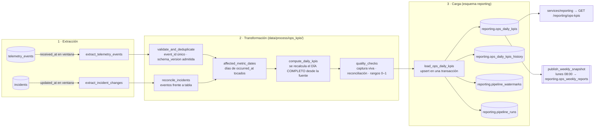

# Pipeline de rendimiento de negocio — Diseño (Parte 1 de 3)

> **Estado:** diseño. Aquí no hay código de orquestación; se implementa en la Parte 2.
> **Fuentes de verdad:** [`company-BRIEFING.md`](../../company-BRIEFING.md) §7 (métricas obligatorias MM-1…MM-7) y §8 (entregable, KPIs y tabla de destino), y el plan de telemetría [`docs/telemetry/telemetry-plan.md`](../../docs/telemetry/telemetry-plan.md).

---

## 1. Estado actual

### 1.1 Qué telemetría hay

| Pieza | Dónde | Qué contiene |
|---|---|---|
| Plan y contrato de eventos | `docs/telemetry/telemetry-plan.md`, `docs/telemetry/event-schemas.json` | 25 `event_type`, con un envelope común (`eventId`, `timestamp`, `receivedAt`, `sessionId`, `userId`, `event_type`, `schemaVersion`, `requestId`, `source`, `properties`) y una allowlist de propiedades para cada uno. |
| Captura | `POST /telemetry` en `services/telemetry/` | Valida el evento contra `event-schemas.json` y lo inserta en `telemetry_events`. Si el `eventId` ya existe, no lo vuelve a insertar (es idempotente). |
| Almacenamiento | Tabla `telemetry_events` en Supabase (Postgres) | Una fila por evento: `event_id` (PK), `event_type`, `occurred_at` (= `timestamp`), `received_at`, `session_id`, `user_id`, `request_id`, `schema_version`, `source_app`, `source_release` y `properties` (jsonb). |
| Informe técnico | `services/telemetry/analysis.py` → `GET /telemetry/report` | Volumen de eventos por tipo y día, tasa de errores (`api_error_occurred` / `api_request_completed`), latencia p50/p95 por ruta y fallos de login en ventana. |

**Tablas de dominio que lee este pipeline** (solo lectura):
- `incidents`: el gestor de incidencias, con `id`, `category`, `status`, `origin`, `branch`, `created_at` y `updated_at`. **Las filas se actualizan en el sitio** cuando cambia el estado, como se ve en la §4.
- `leads`: la cola de solicitudes de onboarding. Hoy es un listado estático en el backoffice; se persistirá cuando se implemente el servicio de solicitudes. Hasta entonces, MM-1, MM-2 y MM-4 se calculan solo con `lead_form_submitted`.

> **Dependencia.** Este diseño se apoya en la captura de telemetría (módulo *Collecting telemetry*) tal como la define el plan. **El pipeline no modifica** `services/telemetry/analysis.py` ni `GET /telemetry/report`, y **no escribe nada** en `telemetry_events`. No necesita ningún campo nuevo en el payload: los eventos obligatorios ya llevan `monthly_volume`, `lead_created_at` e `incident_created_at`.

### 1.2 Qué deja sin responder el informe técnico

El informe técnico contesta preguntas de ingeniería: si el sistema está sano, cuántos eventos llegan, qué endpoints fallan y cuánto tardan. **No contesta ninguna pregunta de la COO**:

- ¿Qué parte de las solicitudes de onboarding llega bien por país, y está mejorando? (MM-1, MM-2)
- ¿Cuánto tardamos en activar una cuenta? (MM-3)
- ¿Qué volumen de envíos tenemos previsto para el próximo mes en México y en España? (MM-4)
- ¿Qué sucursal abre más incidencias, cuánto tardamos en resolverlas y cuántas resolvemos en 72 h o menos? (MM-5, MM-6)

Hoy esas cifras se sacan a mano exportando el CSV del análisis de incidencias (`csv_results_exported`) a una hoja de cálculo. Hacen falta tres cosas que el informe técnico no hace: reglas de negocio (segmentos, objetivo de 72 h), unir telemetría con la tabla `incidents` y un histórico diario auditable. Por eso este pipeline es independiente.

---

## 2. Diseño del pipeline

### 2.1 Propósito

> Producir cada día la tabla `reporting.ops_daily_kpis`, que alimenta el **Informe semanal de operaciones y onboarding** de la **Dirección de Operaciones (COO)**, publicado cada lunes a las 08:00. Calcula `onboarding_conversion_rate`, `lead_validation_error_rate`, `avg_onboarding_time_hours`, `monthly_volume_forecast`, `incidents_opened`, `mean_time_to_resolve_hours` y `resolved_within_72h_rate` a partir de las métricas obligatorias **MM-1 a MM-6**: los eventos `lead_form_submitted`, `lead_status_changed`, `incident_created` e `incident_status_changed`, y la tabla `incidents`.

MM-7 (cambios de estado rechazados) se queda fuera de la v1. Es un indicador de proceso para el equipo, no de resultado de negocio para la COO, y no aparece en los KPI de la §8. Para el propio pipeline, además, `api_request_completed` solo se usa como **señal de que la captura funciona** (§3.2), nunca como KPI.

### 2.2 Formato de extracción

| Fuente | Formato | Filtro | Frecuencia con que cambia |
|---|---|---|---|
| `telemetry_events` | Filas Postgres. `properties` es un jsonb validado contra `event-schemas.json` y versionado con `schema_version` | `event_type IN ('lead_form_submitted','lead_status_changed','incident_created','incident_status_changed','api_request_completed')` **y** `received_at > :watermark AND received_at <= :run_cutoff` | **Solo se añaden filas** y llegan de forma continua. Los eventos de cliente pueden llegar con retraso por lotes, `sendBeacon` o falta de conexión. |
| `incidents` | Filas Postgres | `updated_at > :incidents_watermark AND updated_at <= :run_cutoff` | **Se actualizan en el sitio**: `status` y `updated_at` cambian con cada transición. |

`run_cutoff = now() − 2 min`. Ese margen de seguridad evita leer filas de transacciones que aún no han terminado.

Ejemplo de fila que se extrae (`incident_status_changed`):

```json
{
  "event_id": "8e1c…", "event_type": "incident_status_changed",
  "occurred_at": "2026-10-23T16:40:11Z", "received_at": "2026-10-23T16:40:12Z",
  "schema_version": "1.0.0", "user_id": "12", "request_id": "…",
  "properties": { "incident_id": 96, "from_status": "in_progress", "to_status": "resolved",
                  "category": "delayed_delivery", "branch": "zaragoza", "origin": "branch",
                  "incident_created_at": "2026-10-21T09:02:00Z", "seconds_in_previous_status": 86400 }
}
```

### 2.3 Flujo de datos



**Clave del diseño: recalcular por días afectados.** La extracción no se usa para *sumar* eventos nuevos a un agregado que ya existe. Sirve para saber **qué días** (`date(occurred_at AT TIME ZONE 'Europe/Madrid')`) han recibido datos nuevos. Para cada uno de esos días, la transformación **vuelve a calcular el día entero** leyendo todos sus eventos de `telemetry_events`. Así el resultado de un día solo depende de los datos de ese día, no de cuántas veces se haya ejecutado el pipeline. Sobre esto se apoyan la idempotencia (§3.1) y el tratamiento de eventos tardíos.

### 2.4 Cómo se tratan los registros que se actualizan (`incidents`)

`incidents` no es una tabla en la que solo se añaden filas: cada transición **sobrescribe** `status` y `updated_at`. Si se contara «resueltas» sumando filas cada vez que se extraen, una incidencia que se actualice dos veces contaría dos veces. Mecanismo:

1. **Watermark propio por fuente.** En `reporting.pipeline_watermarks` hay una fila `source='incidents'` con `last_updated_at`, y solo se extraen las filas con `updated_at` por encima. Hay otra fila `source='telemetry_events'` con `last_received_at`.
2. **Los hechos salen de los eventos, la tabla solo se usa para reconciliar.** El momento de la resolución (MM-6) se toma del evento `incident_status_changed` con `to_status='resolved'`, que es inmutable y tiene un `event_id` único. La tabla `incidents` no se agrega. Se usa para **comprobar** que cada incidencia que la tabla da por `resolved` con `updated_at` en el día D tiene su evento. Si falta, se apunta en `reporting.ops_reconciliation_issues` y el día se marca con `data_quality='partial'`.
3. **Clave natural en el destino.** `reporting.ops_daily_kpis` tiene `PRIMARY KEY (metric_date, kpi_name, dimension_type, dimension_value)`. La carga hace `INSERT … ON CONFLICT (…) DO UPDATE` y **sustituye** el valor del día por el recalculado, sin sumarlo.

### 2.5 Tablas de destino (esquema `reporting`)

```sql
-- Tabla de destino del BRIEFING §8 (nombre exacto)
CREATE TABLE reporting.ops_daily_kpis (
  metric_date      date        NOT NULL,              -- día en Europe/Madrid, según occurred_at
  kpi_name         text        NOT NULL CHECK (kpi_name IN ('onboarding_conversion_rate','lead_validation_error_rate',
                     'avg_onboarding_time_hours','monthly_volume_forecast','incidents_opened',
                     'mean_time_to_resolve_hours','resolved_within_72h_rate')),
  dimension_type   text        NOT NULL CHECK (dimension_type IN ('all','country','segment','branch','category')),
  dimension_value  text        NOT NULL,              -- 'all' | 'Mexico' | 'zaragoza' | 'damage' | …
  value            numeric     ,                      -- NULL = no hay denominador (p. ej. ninguna resuelta ese día)
  numerator        numeric     NOT NULL DEFAULT 0,    -- para recalcular el agregado semanal sin promediar medias
  denominator      numeric     NOT NULL DEFAULT 0,
  source_events    integer     NOT NULL,              -- eventos que entraron en el cálculo (0 = actividad nula real)
  data_quality     text        NOT NULL CHECK (data_quality IN ('ok','partial','suspect')),
  revision         integer     NOT NULL DEFAULT 1,    -- aumenta cada vez que un dato tardío cambia el valor
  computed_at      timestamptz NOT NULL,
  run_id           uuid        NOT NULL REFERENCES reporting.pipeline_runs(run_id),
  PRIMARY KEY (metric_date, kpi_name, dimension_type, dimension_value)
);

CREATE TABLE reporting.ops_daily_kpis_history (       -- auditoría: valor anterior a cada revisión
  LIKE reporting.ops_daily_kpis, superseded_at timestamptz NOT NULL, superseded_by_run uuid NOT NULL
);

CREATE TABLE reporting.ops_weekly_reports (           -- foto inmutable de lo que se publicó cada lunes
  iso_week text, kpi_name text, dimension_type text, dimension_value text,
  value numeric, numerator numeric, denominator numeric, published_at timestamptz, run_id uuid,
  PRIMARY KEY (iso_week, kpi_name, dimension_type, dimension_value)
);

CREATE TABLE reporting.pipeline_watermarks (source text PRIMARY KEY, last_value timestamptz NOT NULL, updated_by_run uuid);
CREATE TABLE reporting.ops_reconciliation_issues (run_id uuid, metric_date date, incident_id integer, issue text);
-- reporting.pipeline_runs: ver §3.2
```

Guardar `numerator` y `denominator` permite calcular la semana como `Σnum / Σden`, que es lo correcto. Una media de medias diarias daría el mismo peso a un día con 2 solicitudes que a uno con 200.

### 2.6 Endpoints nuevos (`services/reporting/`)

Es un módulo nuevo, **aparte de `services/telemetry/`**. Ver §5.

---

## 3. Resiliencia e idempotencia

### 3.1 Idempotencia: qué pasa en la segunda ejecución si la primera falla durante la carga

La carga de **todos** los días afectados y el avance de **los dos** watermarks se hacen en **una sola transacción de Postgres**:

```
BEGIN;
  -- para cada fila recalculada:
  INSERT INTO reporting.ops_daily_kpis_history SELECT …, now(), :run_id FROM reporting.ops_daily_kpis
    WHERE (metric_date, kpi_name, dimension_type, dimension_value) = (…) AND value IS DISTINCT FROM :new_value;
  INSERT INTO reporting.ops_daily_kpis (…) VALUES (…)
    ON CONFLICT (metric_date, kpi_name, dimension_type, dimension_value) DO UPDATE
      SET value = EXCLUDED.value, numerator = EXCLUDED.numerator, denominator = EXCLUDED.denominator,
          source_events = EXCLUDED.source_events, data_quality = EXCLUDED.data_quality,
          revision = reporting.ops_daily_kpis.revision
                     + CASE WHEN reporting.ops_daily_kpis.value IS DISTINCT FROM EXCLUDED.value THEN 1 ELSE 0 END,
          computed_at = EXCLUDED.computed_at, run_id = EXCLUDED.run_id;
  UPDATE reporting.pipeline_watermarks SET last_value = :run_cutoff, updated_by_run = :run_id
    WHERE source IN ('telemetry_events','incidents');
COMMIT;
```

**Escenario: la ejecución A falla a mitad de la carga** (por ejemplo, se cae la conexión después de 40 de las 120 filas):
1. Postgres **deshace toda la transacción**. En `ops_daily_kpis` no queda ninguna de esas 40 filas y los watermarks siguen como estaban antes de A. `pipeline_runs` registra A como `failed` con `error_stage='load'`. Ese registro se escribe en una transacción aparte, así que no se pierde.
2. **La ejecución B** lee los mismos watermarks y vuelve a extraer la **misma ventana**, más lo que haya llegado después. Calcula los mismos días afectados, o más, y **vuelve a calcular cada día entero** desde la fuente.
3. El upsert **sustituye** cada valor; no suma nada. Aunque la base de datos hubiera confirmado parte de A, por ejemplo si se cambiara la carga a transacciones por lotes, B escribiría exactamente los mismos valores sobre esas filas. `revision` no sube, porque el valor no cambia.
4. **Resultado:** después de B, la tabla queda igual que si A no hubiera existido y B hubiera sido la primera ejecución limpia.

**Duplicados en el origen.** La clave de deduplicación es **`eventId`** (`telemetry_events.event_id`, PRIMARY KEY), y se aplica en **dos capas**:
- **Ingesta:** `INSERT … ON CONFLICT (event_id) DO NOTHING`, así que un reintento del cliente no crea otra fila.
- **Transformación:** `validate_and_deduplicate` vuelve a deduplicar por `event_id` dentro del lote, por si una ingesta futura deja de hacerlo. Además, para los eventos de negocio que salen de la API aplica una **clave de negocio**: `(incident_id, to_status)` en `incident_status_changed` y `incident_id` en `incident_created`. Se queda con el primer `occurred_at`. Así, si un error de la API emitiera dos veces la misma transición con `eventId` distintos, solo contaría una.

**Eventos tardíos.** Supongamos que el día D ya está publicado y el D+3 llega un `lead_form_submitted` con `occurred_at` en D, por ejemplo porque un navegador volvió a tener conexión. Pasa lo siguiente:
- `received_at` es posterior al watermark, así que el evento se extrae, y D entra en la lista de días afectados.
- D se vuelve a calcular entero. El upsert sustituye el valor, `revision` pasa a 2 y el valor anterior queda guardado en `ops_daily_kpis_history`. No se infla nada, porque es un recálculo y no una suma, y no se pierde la auditoría.
- El informe semanal ya publicado (`ops_weekly_reports`) **no se toca**. El endpoint del informe muestra «Revisado después de publicar: valor publicado X, valor actual Y» comparando las dos tablas.
- Hay un límite de retraso: si `occurred_at` tiene más de 35 días, el evento no recalcula nada. Se registra en `pipeline_runs.late_events_dropped`, para no reabrir meses ya cerrados.

### 3.2 Registro de ejecuciones (`reporting.pipeline_runs`)

| Campo | Tipo | Para qué sirve en una auditoría |
|---|---|---|
| `run_id` | `uuid` PK | Identifica la ejecución. Cada fila de `ops_daily_kpis` apunta a ella, así que de cualquier cifra del informe se puede saber qué ejecución la produjo. |
| `flow_run_id` | `text` | El ID del flow run de Prefect, para ir a sus logs y estados en la UI de Prefect. |
| `pipeline_version` | `text` | El git SHA del código. Si un KPI cambia sin que hayan cambiado los datos, permite ver si fue un cambio de lógica. |
| `trigger_type` | `text` (`schedule`, `manual`, `backfill`) | Indica si la ejecución fue programada o manual. Explica las ejecuciones fuera de horario. |
| `triggered_by` | `text` null | El `userId` de quien la lanzó a mano. Trazabilidad de quién recalculó el informe. |
| `started_at` / `finished_at` | `timestamptz` | Duración y ventana real. Sirven para detectar si el pipeline se vuelve más lento a medida que crecen los datos y para comprobar que terminó antes de las 08:00. |
| `status` | `text` (`running`, `completed`, `failed`, `skipped_locked`) | Estado final. `skipped_locked` deja constancia de que hubo un disparo que no se ejecutó porque ya había otra ejecución en marcha. |
| `window_start` / `window_end` | `timestamptz` | El watermark de entrada y el `run_cutoff`. Permiten comprobar que no hay **huecos ni solapes** entre ejecuciones consecutivas (`window_start` de una = `window_end` de la anterior). |
| `records_extracted` | `jsonb` (`{"incident_created": 41, …}`) | Recuento por tipo de evento. Compararlo con días anteriores sirve para detectar caídas o picos en la captura. |
| `records_rejected` / `duplicates_skipped` | `integer` | Eventos inválidos (versión de esquema no admitida) y duplicados descartados. Si suben los duplicados, el cliente está reintentando demasiado. |
| `late_events_dropped` | `integer` | Eventos ignorados por llegar con más de 35 días de retraso. |
| `affected_dates` | `date[]` | Qué días se volvieron a calcular. Explica por qué cambió una cifra de la semana pasada. |
| `rows_upserted` / `rows_revised` | `integer` | Filas escritas y filas cuyo valor cambió (es decir, revisiones). |
| `data_quality_flags` | `jsonb` | Avisos de calidad por día (`suspect` o `partial`) con su motivo. |
| `error_stage` / `error_message` | `text` null | En qué fase falló (`extract`, `transform`, `load`) y un mensaje **sin datos sensibles**: la clase de la excepción y un resumen, nunca la cadena de conexión. |

**¿No hubo actividad o falló la captura?**
- Cada fila de KPI guarda `source_events`. Una fila con `value=0` y `source_events=0` significa «hubo captura y no pasó nada». Una **fila que no existe** significa «ese día no se calculó». Se distinguen con `pipeline_runs`: ¿hay alguna ejecución `completed` cuyo `affected_dates` o ventana incluya ese día?
- La captura se da por viva si hay al menos un `api_request_completed` cada hora. Si un día tiene 0 eventos de negocio **y** 0 eventos `api_request_completed`, el día se marca `data_quality='suspect'`: lo más probable es que fallara la captura, no que no hubiera actividad.
- `GET /reporting/ops-kpis/status` devuelve el `freshness_minutes` (minutos desde el último `completed`), el `last_received_at` de la fuente y si la ejecución programada de hoy existe. Un pipeline que no ha llegado a ejecutarse se ve porque falta la ejecución.

**Trazabilidad evento → informe.** Una cifra del informe lleva a su fila en `ops_daily_kpis`. De ahí, `run_id` lleva a `pipeline_runs` (ventana y recuentos), y la ventana más `event_type` llevan a las filas de `telemetry_events`. Esas filas tienen `request_id`, que lleva a los logs de la API. Para detectar ráfagas o desfases del intervalo:
- se compara `records_extracted` con la media de los últimos 7 días (más de ±3σ genera un aviso);
- se comprueba que `window_start(n) = window_end(n−1)`.

**¿El negocio crece o se están perdiendo o duplicando datos?** Se usan tres señales independientes:
1. **Reconciliación con la tabla de dominio:** `count(incident_created)` del día frente a `count(*) FROM incidents WHERE date(created_at)=D AND source_ref IS NULL`. Las filas del seed histórico (`source_ref` no nulo) nunca emitieron eventos y se excluyen. Si coinciden, el crecimiento es real. Si los eventos se quedan por debajo de la tabla, se están perdiendo.
2. **Proporción frente al tráfico técnico:** `lead_form_submitted / page_viewed(route='/')`. Si el tráfico se duplica pero la proporción se mantiene, es crecimiento. Si los envíos se duplican con el mismo tráfico, hay que sospechar de duplicados.
3. **`duplicates_skipped` y `records_rejected`** en cada ejecución: si suben, el problema está en la captura, no en el negocio.

### 3.3 Recuperación

- **Se cae la base de datos.** Las tareas de extracción y de carga tienen `retries=3` con espera exponencial (30 s, 2 min, 8 min). Si siguen fallando, el flow termina en `Failed`. El **punto de control** son los watermarks de `reporting.pipeline_watermarks`, que solo avanzan al hacer COMMIT de la carga. La ejecución siguiente empieza desde el último watermark confirmado. Nunca se guarda un avance parcial de la extracción: en la escala de TrackFlow (miles de eventos al día) volver a extraer la ventana entera es barato y mucho más seguro que reanudar a medias.
- **Buffer en el frontend.** Tiene sentido, pero con límites, y **la responsabilidad es de la capa de captura, no del pipeline**. `lib/telemetry.ts` guarda en `localStorage` como máximo 100 eventos o 24 h, para los eventos del website (`lead_form_*`), que son los que pueden quedarse sin conexión.
  - *Riesgos:* datos fuera de orden (los resuelve `occurred_at`), duplicados al reenviar (los resuelve `eventId`), eventos que llegan días después (pasan por el recálculo de eventos tardíos y el límite de 35 días) y datos guardados en el navegador (por eso no hay PII en ningún evento).
  - El pipeline no tiene que hacer nada especial: agrupa por `occurred_at` y extrae por `received_at`, así que los eventos con buffer se tratan solos.
- **Reintentos de `POST /telemetry`.** El cliente reenvía siempre **el mismo `eventId`**, y el servidor responde así:

  | Respuesta | Significado | ¿Reintentar? |
  |---|---|---|
  | `201 Created` | Guardado. | No |
  | `200 OK` `{"status":"duplicate"}` | Ese `eventId` ya estaba guardado. Se considera **éxito**. | No |
  | `400` / `422` | El evento no cumple `event-schemas.json`. | **No** (reintentarlo nunca lo arreglará). Se descarta y se cuenta. |
  | `429` / `503` (con `Retry-After`) / error de red | Saturación o fallo temporal. | Sí, como máximo 3 veces, con backoff exponencial y jitter. |

  En un envío por lotes, la respuesta trae un resultado por cada `eventId`. Así el cliente reintenta solo los que dieron `429` o `5xx`.

### 3.4 Ejecuciones concurrentes

- **Cómo se detecta.** Al empezar, el flow pide `pg_try_advisory_lock(hashtext('reporting.ops_daily_kpis'))`. Si no lo consigue, hay otra ejecución en marcha. En ese caso termina enseguida con `status='skipped_locked'` y deja constancia en `pipeline_runs`. Prefect además aplica un **límite de concurrencia** de 1 en la etiqueta `ops-kpis`.
- **Si coinciden el cron y un disparo manual.** El disparo manual (`POST /reporting/ops-kpis/runs`) consulta primero el estado. Si hay una ejecución `running`, responde **`409 Conflict`** con su `run_id`, en lugar de encolar otra. Si las dos llegan a la vez, el lock lo resuelve: solo una carga y la otra queda como `skipped_locked`.
- **Por qué esto basta.** Aunque dos ejecuciones llegaran a cargar una detrás de otra, las dos recalculan días completos desde la fuente y hacen upsert, así que la segunda escribiría los mismos valores. El lock evita trabajo repetido y deja limpia la línea de watermarks, pero la corrección de los datos no depende de él.

---

## 4. Correspondencia con Prefect

```
data/pipelines/ops_kpis/
├── flows.py        # ops_daily_kpis_flow, ops_kpis_backfill_flow, publish_weekly_report_flow
├── tasks.py        # tareas de abajo (solo orquestación y E/S)
├── status.py       # get_pipeline_status(), trigger_ops_kpis_run(), query_ops_daily_kpis(), get_weekly_report()
└── deployments.py  # programación (cron) y límites de concurrencia
data/process/ops_kpis/
└── kpis.py         # funciones puras: compute_daily_kpis(events, incidents, day) → filas
```

| Concepto en Prefect | Nombre | Qué hace |
|---|---|---|
| **Flow principal** | `ops_daily_kpis_flow(trigger_type="schedule", triggered_by=None)` | Ejecución incremental: extracción, transformación y carga desde el watermark. |
| Flow opcional | `ops_kpis_backfill_flow(start_date, end_date)` | Recalcula un rango de días sin tocar los watermarks (por ejemplo, tras corregir una fórmula). Se ignora el límite de 35 días. |
| Flow opcional | `publish_weekly_report_flow(iso_week)` | Copia la semana a `ops_weekly_reports`, que queda inmutable. |
| Task | `acquire_run_lock` | Pide el advisory lock y crea la fila en `pipeline_runs`. |
| Task | `extract_telemetry_events(window)` | Lee `telemetry_events` por `received_at` (retries=3). |
| Task | `extract_incident_changes(window)` | Lee `incidents` por `updated_at` (retries=3). |
| Task | `validate_and_deduplicate(events)` | Filtra por `schema_version` admitida y deduplica por `event_id` y por clave de negocio. |
| Task | `compute_daily_kpis(affected_dates)` | Recalcula los días afectados con `data/process/ops_kpis/kpis.py`. |
| Task | `run_quality_checks(rows)` | Comprueba la reconciliación, la señal de captura viva y que las tasas estén entre 0 y 1. Asigna `data_quality`. |
| Task | `load_ops_daily_kpis(rows, watermarks)` | Transacción única: historial, upsert y watermarks (retries=3). |
| Task | `record_run(result)` | Cierra la fila de `pipeline_runs`. Se ejecuta **también si el flow falla** (`allow_failure`). |

**Estados que importan.**
- `Scheduled` y `Pending`: la ejecución programada existe. Si a las 06:15 no hay ninguna, se alerta.
- `Running`.
- `Retrying`: en extracción y carga, por fallos de conexión.
- `Completed`: el KPI se puede usar.
- `Failed`: se alerta al equipo de datos y el informe del lunes muestra «datos de hace N h».
- `Crashed`: lo mismo que `Failed`. Una `pipeline_runs` que se queda en `running` más de 30 min se marca como `failed`.
- `Cancelled`.

**Bloques de configuración.**
- `SqlAlchemyConnector` **`supabase-reporting`**: la conexión a Supabase. Lee `telemetry_events` e `incidents` y escribe en `reporting.*`. El usuario de base de datos solo puede leer esas tablas y solo puede escribir en el esquema `reporting`.
- `Secret` **`supabase-reporting-password`**: la contraseña de ese usuario. Nunca está en el código ni en `.env` versionado.
- `JSON` **`ops-kpis-config`**: `{"timezone": "Europe/Madrid", "safety_lag_minutes": 2, "late_event_max_days": 35, "sla_hours": 72, "supported_schema_versions": ["1"]}`.
- **Programación:**
  - `ops_daily_kpis_flow`: cron `0 6 * * *` (Europe/Madrid).
  - `publish_weekly_report_flow`: cron `0 8 * * 1`.

---

## 5. Integración con la aplicación (diseño)

El módulo nuevo es `services/reporting/`, con el router `/reporting`. Solo pueden usarlo los roles `admin` y `manager` (con `get_current_user` y comprobación del rol). Está **separado** de `services/telemetry/` y de `GET /telemetry/report`. Los endpoints **no tienen lógica ETL**: importan funciones de `data/pipelines/ops_kpis/status.py`.

| Endpoint | Para qué | Función que llama en `data/pipelines/` | Respuesta |
|---|---|---|---|
| `GET /reporting/ops-kpis/status` | Estado y frescura de los datos | `ops_kpis.status.get_pipeline_status()` | `{last_run: {run_id, status, started_at, finished_at, rows_upserted}, running: bool, freshness_minutes, last_received_at, data_quality_flags}` |
| `POST /reporting/ops-kpis/runs` | Lanzar una ejecución a mano | `ops_kpis.status.trigger_ops_kpis_run(triggered_by=user.id)`. Usa `prefect.deployments.run_deployment("ops_daily_kpis_flow/daily")`. | `202 {run_id, flow_run_id}` · `409 {running_run_id}` si ya hay una en marcha |
| `GET /reporting/ops-kpis?from=2026-10-19&to=2026-10-25&kpi=incidents_opened&dimension_type=branch` | Consulta de KPI, la que usará el dashboard de la Parte 3 | `ops_kpis.status.query_ops_daily_kpis(date_from, date_to, kpi, dimension_type)` | Filas diarias con `value`, `numerator`, `denominator`, `data_quality` y `revision` |
| `GET /reporting/ops-kpis/weekly?week=2026-W43` (opcional) | El informe del lunes tal como se publicó | `ops_kpis.status.get_weekly_report(iso_week)` | Valores publicados y revisiones posteriores, si las hay |

La dependencia va en un solo sentido: `services/reporting` → `data/pipelines` → `data/process`. Nunca al revés.

---

## 6. Respuestas a las preguntas de diseño (resumen)

| Pregunta | Respuesta en este diseño |
|---|---|
| Duplicados en origen | La clave es `eventId`, con `ON CONFLICT DO NOTHING` en la ingesta, y se vuelve a deduplicar en `validate_and_deduplicate` por `event_id` y por clave de negocio (§3.1). |
| Reejecución tras fallo | La carga y los watermarks van en una sola transacción, y se recalculan días completos con upsert. La segunda ejecución da lo mismo que una ejecución limpia (§3.1). |
| Eventos tardíos | Se extraen por `received_at` y se agrupan por `occurred_at`. El día afectado se recalcula entero, sube `revision` y el valor anterior va a `history`. Lo ya publicado no se toca (§3.1). |
| Silencio o ausencia de datos | `source_events` por fila, `api_request_completed` como señal de que la captura funciona, `data_quality='suspect'`, `pipeline_runs` y `freshness_minutes` (§3.2). |
| Trazabilidad | KPI → `run_id` → ventana → `telemetry_events` → `request_id` → logs. Se comprueba que no haya huecos entre ventanas (§3.2). |
| Crecimiento o pérdida de datos | Reconciliación con `incidents`, proporciones frente a `page_viewed`, y seguimiento de `duplicates_skipped` y `records_rejected` (§3.2). |
| Caída de la base de datos | Reintentos de Prefect, y el watermark solo avanza al hacer COMMIT. La ejecución siguiente empieza desde ahí (§3.3). |
| Buffer en el frontend | Con límite de 100 eventos o 24 h. Es responsabilidad de `lib/telemetry.ts`, y el pipeline no necesita lógica especial (§3.3). |
| Reintentos de `POST /telemetry` | Mismo `eventId`. `200 duplicate` = ya estaba guardado. `400/422` no se reintenta. `429/5xx` se reintenta con backoff (§3.3). |
| Ejecuciones concurrentes | Advisory lock, límite de concurrencia de Prefect y `409` en el disparo manual. Además, el recálculo con upsert es seguro aunque se solapen (§3.4). |
