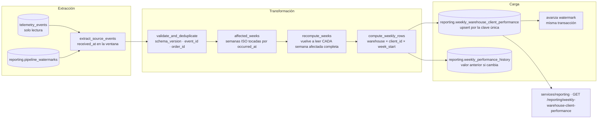

# Pipeline de desempeño de negocio — Diseño (Parte 1 de 3)

> **Estado:** diseño. Aquí no hay código de orquestación; se implementa en la Parte 2.
> **Fuentes de verdad:** el briefing oficial del pipeline [`docs/briefings/06-data-pipelines.es.md`](../../docs/briefings/06-data-pipelines.es.md) (entregable, KPIs, agregación, tabla de destino y endpoints) y el de telemetría [`docs/briefings/06-telemetry.es.md`](../../docs/briefings/06-telemetry.es.md) §3 (métricas obligatorias), con su plan en [`docs/telemetry/telemetry-plan.md`](../../docs/telemetry/telemetry-plan.md).

---

## 1. Estado actual

### 1.1 Qué telemetría hay

| Pieza | Dónde | Estado |
|---|---|---|
| Plan y contrato de eventos | `docs/telemetry/telemetry-plan.md`, `docs/telemetry/event-schemas.json` | Hecho. 30 `event_type` con un envelope común (`eventId`, `timestamp`, `receivedAt`, `sessionId`, `userId`, `event_type`, `schemaVersion`, `requestId`, `source`, `properties`). Los 5 obligatorios son de inventario: `inbound_order_created`, `outbound_order_created`, `stock_threshold_triggered`, `direct_stock_edit_rejected` e `inventory_discrepancy_detected`. |
| Captura | `services/api/routes/telemetry.py` (stub) + `lib/telemetry.ts` en website y backoffice | En curso, en la rama `feature/telemetry-capture`. El endpoint stub valida y descarta; todavía no persiste. |
| Almacenamiento | Tabla `telemetry_events` en Supabase | Pendiente (proyecto *Company's Telemetry – Storage*). Este diseño asume el esquema del plan: `event_id` (PK), `event_type`, `occurred_at` (= `timestamp`), `received_at`, `session_id`, `user_id`, `request_id`, `schema_version`, `source_app`, `source_release` y `properties` (jsonb). |
| Informe técnico | `services/telemetry/analysis.py` → `GET /telemetry/report` | Pendiente (proyecto *Technical Report*). Responderá a preguntas de ingeniería: volumen por tipo de evento, tasa de errores, latencia p50/p95 y fallos de login. |
| Dominio de inventario | `services/api/inventory` (Milestone 5) | Hecho. `SKU` (con `client_name`, `category` y `warehouse` `LA`/`ZGZ`), `StockEntry` y `StockExit`. El stock solo cambia mediante órdenes. |

> **Dependencias.** El pipeline necesita que la captura y el almacenamiento de los 4 eventos de origen estén en marcha. No modifica `services/telemetry/analysis.py` ni `GET /telemetry/report`, y **nunca escribe** en `telemetry_events` (briefing §7).

### 1.2 Qué deja sin responder el informe técnico

El informe técnico dice si el sistema está sano. **No responde a la pregunta de Thomas y Ana:** ¿cómo está funcionando cada almacén con cada cliente esta semana?

- ¿Cuántas unidades ha recibido Los Ángeles de cada marca, y cuántas Zaragoza? (Volumen de entrada)
- ¿Cuántos pedidos ha despachado cada almacén para cada marca? (Throughput de salida)
- ¿Qué marca se está quedando sin stock y en qué almacén? (Frecuencia de quiebre de stock)
- ¿En qué combinaciones de almacén y cliente hay que hacer una auditoría? (Tasa de discrepancia)

Hoy cada director monta esas cifras a mano el domingo por la noche, durante horas, y llegan con uno o dos días de retraso. Hacen falta cosas que el informe técnico no hace: agregar por **cliente** y **semana ISO**, aplicar las reglas de negocio de cada KPI y guardar un histórico semanal auditable. Por eso este pipeline es independiente.

---

## 2. Diseño del pipeline

### 2.1 Propósito

> Producir cada semana la tabla `reporting.weekly_warehouse_client_performance`, que alimenta el **«Reporte Semanal de Desempeño por Almacén y Cliente»** de **Thomas (CEO) y Ana (Head of Warehouse Operations)**, fresco el lunes por la mañana. Calcula **volumen de entrada**, **throughput de salida**, **frecuencia de quiebre de stock** y **tasa de discrepancia** a partir de las métricas obligatorias `inbound_order_created`, `outbound_order_created`, `stock_threshold_triggered` e `inventory_discrepancy_detected`.

`direct_stock_edit_rejected` también es obligatorio en telemetría, pero el briefing no lo usa para ningún KPI de este pipeline y pide no ampliar el alcance de la v1. Se queda fuera.

### 2.2 Formato de extracción

| Fuente | Formato | Cómo se lee | Frecuencia de actualización |
|---|---|---|---|
| `telemetry_events` (Supabase Postgres) | Una fila por evento; el payload en `properties` (jsonb) | `SELECT … WHERE event_type IN (4 tipos) AND received_at > :watermark AND received_at <= :run_cutoff` | Continua: la ingesta escribe en cuanto llega cada lote del cliente o de la API. |

Campos que se usan de cada evento (todos están en la allowlist del plan):

| `event_type` | Campos de `properties` | Para qué KPI |
|---|---|---|
| `inbound_order_created` | `warehouse`, `client_id`, `quantity` | `inbound_units_count` (suma de `quantity`) |
| `outbound_order_created` | `warehouse`, `client_id` | `outbound_orders_count` (conteo) y denominador de `discrepancy_rate` |
| `stock_threshold_triggered` | `warehouse`, `client_id` | `stockout_events_count` (conteo) |
| `inventory_discrepancy_detected` | `warehouse`, `client_id` | `discrepancy_events_count` (conteo) y numerador de `discrepancy_rate` |

- **Semana:** `week_start` = lunes de la semana ISO de `occurred_at`, en **UTC**, como dice el briefing.
- **`run_cutoff`** = `now() − 2 min` (margen de seguridad), para no leer transacciones de ingesta que todavía no han hecho COMMIT.

Ejemplo de fila de origen:

```json
{
  "event_id": "7c1e0b9a-4d2f-4a8e-9b61-3f2a1c0d5e77",
  "event_type": "outbound_order_created",
  "occurred_at": "2026-11-17T15:42:10.381Z",
  "received_at": "2026-11-17T15:42:11.004Z",
  "properties": {
    "order_id": 3381, "warehouse": "zaragoza", "client_id": "purestep-footwear",
    "product_id": "CLT-SNK-W-42", "product_category": "fashion",
    "quantity": 2, "exit_type": "dispatch", "stock_after": 38
  }
}
```

### 2.3 Flujo de datos



Las tres etapas están separadas: la extracción **solo lee**, la transformación usa funciones puras (`data/process/weekly_performance/kpis.py`) sin E/S, y la carga es **una única transacción**.

### 2.4 Cómo se tratan los registros que se actualizan

`telemetry_events` es **append-only**: un evento no cambia después de guardarse. Lo que sí «se actualiza» son las **semanas ya calculadas**, cuando llega tarde un evento de una semana pasada. Por ejemplo, un `inventory_discrepancy_detected` de un conteo del viernes que se registra el lunes. La estrategia para no duplicar nada es:

1. **Watermark por `received_at`.** Se extraen solo los eventos recibidos desde la última ejecución confirmada (`reporting.pipeline_watermarks`, fila `source='telemetry_events'`).
2. **Recalcular semanas completas, nunca sumar.** Con esos eventos se obtiene la lista de semanas afectadas (por `occurred_at`). Cada semana afectada se vuelve a calcular **entera** desde `telemetry_events`, no solo con los eventos nuevos.
3. **Upsert sobre la clave única del briefing** `unique (warehouse, client_id, week_start)`: el valor recalculado **sustituye** al anterior. Si cambia, el valor previo se guarda en `reporting.weekly_performance_history` con el `run_id` que lo revisó.

Así, procesar dos veces el mismo evento nunca infla una cifra: la segunda vez la semana se recalcula y da el mismo resultado.

### 2.5 Tablas de destino (esquema `reporting`)

**Tabla de KPIs, con el nombre exacto del briefing:**

```sql
create table reporting.weekly_warehouse_client_performance (
  id uuid primary key default gen_random_uuid(),
  warehouse text not null,                         -- 'los_angeles' | 'zaragoza'
  client_id text not null,                         -- slug de la marca, ej. 'purestep-footwear'
  week_start date not null,                        -- lunes de la semana ISO (UTC)
  inbound_units_count integer not null default 0,  -- Volumen de entrada
  outbound_orders_count integer not null default 0,-- Throughput de salida
  stockout_events_count integer not null default 0,-- Frecuencia de quiebre de stock
  discrepancy_events_count integer not null default 0,
  discrepancy_rate numeric not null default 0,     -- discrepancy_events_count / outbound_orders_count (0 si no hubo salidas)
  computed_at timestamptz not null default now(),
  unique (warehouse, client_id, week_start)
);
```

Tablas de apoyo, que no exige el briefing pero hacen falta para auditar:

```sql
create table reporting.pipeline_runs (            -- registro de ejecuciones (§3.2)
  run_id uuid primary key, flow_run_id text, pipeline_version text,
  trigger_type text not null, triggered_by text,
  started_at timestamptz not null, finished_at timestamptz,
  status text not null,                            -- running | completed | failed | skipped_locked
  window_start timestamptz, window_end timestamptz,
  records_extracted jsonb, records_rejected integer, duplicates_skipped integer,
  affected_weeks date[], rows_upserted integer, rows_revised integer,
  error_stage text, error_message text
);
create table reporting.pipeline_watermarks (source text primary key, last_value timestamptz not null, updated_by_run uuid);
create table reporting.weekly_performance_history (   -- valor anterior de cada fila revisada
  like reporting.weekly_warehouse_client_performance, superseded_at timestamptz not null, superseded_by_run uuid not null
);
```

**Reglas del briefing que se cumplen en la tabla:** una fila pertenece a un único cliente (la clave incluye `client_id`) y no hay dimensión de moneda.

### 2.6 Endpoints nuevos (`services/reporting/`)

Es un módulo nuevo, **separado de `services/telemetry/`** y de `GET /telemetry/report`. El detalle está en la §5.

---

## 3. Resiliencia e idempotencia

### 3.1 Idempotencia: qué pasa en la segunda ejecución si la primera falla durante la carga

La carga de **todas** las semanas afectadas y el avance del watermark van en **una sola transacción de Postgres**:

```sql
BEGIN;
  -- para cada fila (warehouse, client_id, week_start) recalculada:
  INSERT INTO reporting.weekly_performance_history
    SELECT p.*, now(), :run_id FROM reporting.weekly_warehouse_client_performance p
    WHERE (p.warehouse, p.client_id, p.week_start) = (:w, :c, :ws)
      AND (p.inbound_units_count, p.outbound_orders_count, p.stockout_events_count, p.discrepancy_events_count)
          IS DISTINCT FROM (:inb, :outb, :stk, :disc);
  INSERT INTO reporting.weekly_warehouse_client_performance
    (warehouse, client_id, week_start, inbound_units_count, outbound_orders_count,
     stockout_events_count, discrepancy_events_count, discrepancy_rate, computed_at)
  VALUES (:w, :c, :ws, :inb, :outb, :stk, :disc, :rate, now())
  ON CONFLICT (warehouse, client_id, week_start) DO UPDATE SET
    inbound_units_count = EXCLUDED.inbound_units_count,
    outbound_orders_count = EXCLUDED.outbound_orders_count,
    stockout_events_count = EXCLUDED.stockout_events_count,
    discrepancy_events_count = EXCLUDED.discrepancy_events_count,
    discrepancy_rate = EXCLUDED.discrepancy_rate,
    computed_at = EXCLUDED.computed_at;
  UPDATE reporting.pipeline_watermarks SET last_value = :run_cutoff, updated_by_run = :run_id
    WHERE source = 'telemetry_events';
COMMIT;
```

**Escenario: la ejecución A falla a mitad de la carga**, por ejemplo tras escribir 40 de 120 filas:
1. Postgres **deshace toda la transacción**: no queda ninguna de esas 40 filas y el watermark sigue como antes de A. `pipeline_runs` registra A como `failed` con `error_stage='load'`. Ese registro va en una transacción aparte, así que no se pierde.
2. **La ejecución B** lee el mismo watermark, vuelve a extraer la misma ventana (más lo que haya llegado después) y recalcula cada semana afectada **entera**.
3. El upsert **sustituye**, no suma. Aunque A hubiera llegado a confirmar parte de las filas, B escribiría los mismos valores encima.
4. **Resultado:** después de B, la tabla queda exactamente como si A no hubiera existido.

**Duplicados en origen.** La clave de deduplicación es **`eventId`** (`telemetry_events.event_id`, PRIMARY KEY), y se aplica en dos capas:
- **Ingesta:** `INSERT … ON CONFLICT (event_id) DO NOTHING`.
- **Transformación:** `validate_and_deduplicate` vuelve a deduplicar por `event_id` dentro del lote. Además, en `inbound_order_created` y `outbound_order_created` aplica una **clave de negocio** (`order_id`), porque cada orden debe contar una sola vez. Si un reintento de la API emitiera la misma orden con dos `eventId` distintos, solo se cuenta el primero (por `occurred_at`).

**Eventos tardíos.** Ejemplo: el lunes 24 a las 09:00 llega un `inventory_discrepancy_detected` con `occurred_at` del viernes 21, y la semana del 17 ya está publicada.
- `received_at` es posterior al watermark, así que el evento se extrae y la semana del 17 entra en `affected_weeks`.
- Se recalcula esa semana entera. `discrepancy_events_count` y `discrepancy_rate` cambian, el valor anterior va a `weekly_performance_history` con el `run_id` de esta ejecución, y no se infla nada.
- **Límite de retraso:** los eventos con `occurred_at` de hace más de 8 semanas no reabren semanas cerradas. Se cuentan en `pipeline_runs.records_rejected` con el motivo `late`.

### 3.2 Registro de ejecuciones (`reporting.pipeline_runs`)

| Campo | Por qué hace falta en producción |
|---|---|
| `run_id` | Identifica la ejecución. Cada revisión del histórico apunta a ella: de cualquier cifra se sabe qué ejecución la produjo. |
| `flow_run_id` | ID del flow run de Prefect, para ir a sus logs y estados. |
| `pipeline_version` | Git SHA del código. Si un KPI cambia sin datos nuevos, indica si cambió la lógica. |
| `trigger_type` / `triggered_by` | `schedule`, `manual` o `backfill`, y el `userId` que lo lanzó. Explica las ejecuciones fuera de horario y quién recalculó el informe. |
| `started_at` / `finished_at` | Duración y comprobación de que el informe estaba listo antes del lunes por la mañana. |
| `status` | `running`, `completed`, `failed` o `skipped_locked` (otra ejecución en marcha). |
| `window_start` / `window_end` | Watermark de entrada y `run_cutoff`. Sirven para comprobar que no hay **huecos ni solapes**: `window_start(n) = window_end(n−1)`. |
| `records_extracted` | Recuento por `event_type`. Compararlo con semanas anteriores detecta caídas o picos de captura. |
| `records_rejected` / `duplicates_skipped` | Eventos inválidos o tardíos, y duplicados descartados. Si suben, el problema está en la captura, no en el negocio. |
| `affected_weeks` | Qué semanas se recalcularon. Explica por qué cambió una cifra ya publicada. |
| `rows_upserted` / `rows_revised` | Filas escritas y filas cuyo valor cambió. |
| `error_stage` / `error_message` | Fase del fallo (`extract`, `transform` o `load`) y un mensaje **sin secretos**: la clase de la excepción, nunca la cadena de conexión. |

**¿Sin actividad o captura caída?** Si una combinación almacén/cliente tiene 0 salidas en una semana, puede ser que la marca no haya vendido o que la captura se haya roto. Para distinguirlo:
- **Reconciliación con el dominio:** `count(outbound_order_created)` de la semana frente a `count(*) FROM stock_exit WHERE created_at en esa semana`, por almacén. Si coinciden, el 0 es real. Si los eventos quedan por debajo de la tabla, se están perdiendo eventos y la semana se marca como sospechosa en `pipeline_runs`.
- **Heartbeat:** si en una ventana de 24 h no llega ningún evento de inventario de un almacén que tiene órdenes en el dominio, se alerta («silencio de captura en Zaragoza»).
- **`GET /reporting/pipeline-runs/latest`** muestra cuándo terminó la última ejecución. Un pipeline que no llegó a ejecutarse se ve porque falta la ejecución.

**Trazabilidad evento → informe.** Una cifra del informe lleva a su fila (clave única). De ahí, `pipeline_runs` (por `affected_weeks`) da la ventana, la ventana más el `event_type` dan las filas de `telemetry_events`, y su `request_id` lleva a los logs de la API.

**¿Crecimiento o pérdida de datos?** Se usan tres señales independientes: la reconciliación con `stock_entry` y `stock_exit`, la proporción eventos/órdenes por almacén (debería quedarse cerca de 1), y la evolución de `duplicates_skipped`.

### 3.3 Recuperación

- **Se cae la base de datos.** Las tareas de extracción y carga tienen `retries=3` con espera exponencial (30 s, 2 min y 8 min). Si siguen fallando, el flow termina en `Failed` y el watermark no se mueve. La siguiente ejecución vuelve a empezar desde el último COMMIT. Con el volumen de TrackFlow (cientos de órdenes al día), volver a extraer la ventana entera es barato y más seguro que reanudar a medias.
- **Reintentos de `POST /telemetry`.** Siempre con **el mismo `eventId`**: `201` guardado, `200 duplicate` ya estaba (éxito), `400`/`422` no se reintenta, y `429`/`503` se reintenta como máximo 3 veces con backoff. Los eventos de inventario se emiten en la API, así que no dependen del navegador.

### 3.4 Ejecuciones concurrentes

- Al empezar, el flow pide `pg_try_advisory_lock(hashtext('reporting.weekly_warehouse_client_performance'))`. Si no lo consigue, termina con `status='skipped_locked'`. Prefect añade un límite de concurrencia de 1 en la etiqueta `weekly-performance`.
- `POST /reporting/pipeline-runs` responde **`409 Conflict`** con el `run_id` en marcha en vez de encolar otra ejecución.
- Aunque dos ejecuciones cargaran seguidas, ambas recalculan semanas completas con upsert, así que la segunda escribiría los mismos valores. El lock evita trabajo repetido, pero la corrección de los datos no depende de él.

---

## 4. Correspondencia con Prefect

```
data/pipelines/weekly_performance/
├── flows.py        # weekly_performance_flow, weekly_performance_backfill_flow
├── tasks.py        # las tareas de abajo (solo orquestación y E/S)
├── status.py       # get_latest_run(), trigger_run(), query_weekly_performance()
└── deployments.py  # programación y límite de concurrencia
data/process/weekly_performance/
└── kpis.py         # funciones puras: compute_weekly_rows(events, week_start) → filas
```

| Concepto en Prefect | Nombre | Qué hace |
|---|---|---|
| **Flow principal** | `weekly_performance_flow(trigger_type="schedule", triggered_by=None)` | Extracción, transformación y carga incrementales desde el watermark. |
| Flow opcional | `weekly_performance_backfill_flow(from_week, to_week)` | Recalcula un rango de semanas sin mover el watermark (por ejemplo, tras corregir una fórmula). |
| Task | `acquire_run_lock` | Advisory lock y alta de la fila en `pipeline_runs`. |
| Task | `extract_source_events(window)` | Lee los 4 `event_type` de `telemetry_events` por `received_at` (retries=3). |
| Task | `validate_and_deduplicate(events)` | Filtra por `schema_version` admitida y deduplica por `event_id` y `order_id`. |
| Task | `compute_weekly_rows(affected_weeks)` | Recalcula cada semana afectada completa con `kpis.py`. |
| Task | `run_quality_checks(rows)` | Reconciliación con `stock_entry`/`stock_exit`, `0 ≤ discrepancy_rate`, y 0 cuando `outbound_orders_count = 0`. |
| Task | `load_weekly_performance(rows, run_cutoff)` | Transacción única: historial, upsert y watermark (retries=3). |
| Task | `record_run(result)` | Cierra la fila de `pipeline_runs`. Se ejecuta **también si el flow falla** (`allow_failure`). |

**Estados que importan:** `Scheduled` (si el lunes a las 06:15 no hay ejecución programada, se alerta), `Running`, `Retrying` (fallos de conexión en extracción o carga), `Completed` (el informe se puede usar), `Failed` y `Crashed` (alerta al equipo de datos; el informe muestra «datos de hace N h»). Una `pipeline_runs` que se queda en `running` más de 30 min se marca `failed`.

**Bloques de configuración:**
- `SqlAlchemyConnector` **`supabase-reporting`**: conexión a Supabase con un usuario que **solo puede leer** `telemetry_events`, `stock_entry` y `stock_exit`, y **solo puede escribir** en el esquema `reporting`.
- `Secret` **`supabase-reporting-password`**: la contraseña de ese usuario. Nunca va en el código ni en `.env` versionado.
- `JSON` **`weekly-performance-config`**: `{"week_timezone": "UTC", "safety_lag_minutes": 2, "late_event_max_weeks": 8, "supported_schema_versions": ["1"]}`.
- **Programación:** `weekly_performance_flow` diario a las 05:00 UTC, para que la semana en curso se vaya actualizando, y obligatorio el lunes a las 05:00 UTC, que cierra la semana anterior antes de que Thomas abra el informe.

---

## 5. Integración con la aplicación (diseño)

Módulo nuevo `services/reporting/`, con el router `/reporting`. Solo pueden usarlo los roles `admin` y `manager`. Está **separado** de `services/telemetry/` y de `GET /telemetry/report`, y **no contiene lógica ETL**: importa funciones de `data/pipelines/weekly_performance/status.py`.

| Endpoint (briefing §6) | Para qué | Función que llama en `data/pipelines/` | Respuesta |
|---|---|---|---|
| `GET /reporting/weekly-warehouse-client-performance?week_start=2026-11-16` | **Consulta de KPIs** (la usará el dashboard de la Parte 3). Sin `week_start`, devuelve la última semana calculada. | `weekly_performance.status.query_weekly_performance(week_start)` | `{"week_start": "2026-11-16", "entries": [{"warehouse", "client_id", "inbound_units_count", "outbound_orders_count", "stockout_events_count", "discrepancy_events_count", "discrepancy_rate"}]}` |
| `GET /reporting/pipeline-runs/latest` | **Estado** y metadatos de la última ejecución | `weekly_performance.status.get_latest_run()` | `{run_id, status, started_at, finished_at, window_start, window_end, rows_upserted, rows_revised, affected_weeks}` |
| `POST /reporting/pipeline-runs` | **Disparo manual** | `weekly_performance.status.trigger_run(triggered_by=user.id)`, que usa `prefect.deployments.run_deployment("weekly_performance_flow/default")` | `202 {run_id, flow_run_id}` · `409 {running_run_id}` si ya hay una en marcha |

La dependencia va en un solo sentido: `services/reporting` → `data/pipelines` → `data/process`. Nunca al revés.

---

## 6. Respuestas a las preguntas de diseño (resumen)

| Pregunta | Respuesta en este diseño |
|---|---|
| Duplicados en origen | `eventId` como clave en la ingesta (`ON CONFLICT DO NOTHING`), y de nuevo en la transformación por `event_id` y por `order_id` (§3.1). |
| Reejecución tras fallo | Carga y watermark en una sola transacción, recálculo de semanas completas y upsert por la clave única del briefing: la segunda ejecución da lo mismo que una limpia (§3.1). |
| Eventos tardíos | Se extraen por `received_at` y se agrupan por `occurred_at`. La semana afectada se recalcula entera y el valor anterior va al histórico. Límite de 8 semanas (§3.1). |
| Silencio o ausencia de datos | Reconciliación con `stock_entry`/`stock_exit`, heartbeat por almacén y `pipeline-runs/latest` (§3.2). |
| Trazabilidad | KPI → clave única → `pipeline_runs` → ventana → `telemetry_events` → `request_id` → logs; y comprobación de huecos entre ventanas (§3.2). |
| Crecimiento o pérdida | Proporción eventos/órdenes por almacén, reconciliación con el dominio y evolución de `duplicates_skipped` (§3.2). |
| Caída de la base de datos | Reintentos de Prefect; el watermark solo avanza al hacer COMMIT (§3.3). |
| Ejecuciones concurrentes | Advisory lock, límite de concurrencia de Prefect y `409` en el disparo manual; el upsert hace que un solape sea inofensivo (§3.4). |
