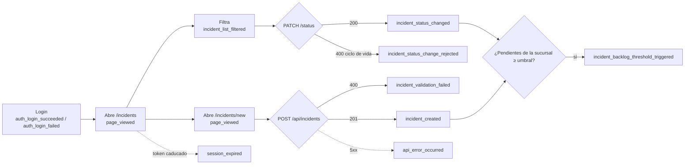

# Plan de telemetría — TrackFlow

> Respuesta al RFI de dirección: qué datos merece la pena capturar en la plataforma de TrackFlow, por qué y cómo. Es un documento de **diseño**: todavía no se instrumenta nada.
> Entregables: este documento y [`event-schemas.json`](event-schemas.json), que es JSON Schema draft-07. Los dos se generan a partir del mismo catálogo, así que siempre coinciden.
> Fuente de verdad del dominio: [`company-BRIEFING.md`](../../company-BRIEFING.md) (sección §7, métricas obligatorias) y [`CONTEXT.md`](../../CONTEXT.md).

## 0. Resumen

- **25 eventos** diseñados: **5 obligatorios**, que cubren las 7 métricas MM-1…MM-7 del BRIEFING, y **20 oportunidades** identificadas.
- **Categorías cubiertas**: negocio (onboarding, incidencias y proveedores), autenticación, navegación, errores y rendimiento.
- **Entrega**: 4 eventos en *stream* (seguridad, errores en producción y saturación de sucursales) y 21 en *batch*.
- **Privacidad**: ningún evento lleva email, nombre, teléfono, dirección ni texto libre. El único identificador derivado de un dato personal es `email_hash` en `auth_login_failed`, calculado con un HMAC de clave secreta.

## 1. Alcance y punto de partida

TrackFlow no tiene un sistema de inventario. Su proceso operativo central es el **gestor de incidencias**: alta → ciclo de vida → resolución, con reglas que el servidor hace cumplir. Por eso, en este plan las piezas que el enunciado describe para un inventario se traducen así:

| Concepto del enunciado (inventario) | Equivalente en TrackFlow |
|---|---|
| Pedido de entrada/salida trazable a un usuario | Alta (`POST /api/incidents`) y cambio de estado (`PATCH …/status`) de una incidencia, siempre con un usuario autenticado |
| Intento de modificar el stock directamente (rechazado) | Intento de transición fuera del ciclo de vida o sobre un estado final → `incident_status_change_rejected` |
| Validación fallida | `POST /api/incidents` con 400 → `incident_validation_failed` |
| Alerta de umbral mínimo de stock | La sucursal supera N incidencias pendientes → `incident_backlog_threshold_triggered` |

Además se cubren las otras partes de la plataforma que hoy son una caja negra:
- el **formulario de onboarding** del website, que alimenta los KPI de `CONTEXT.md` §7;
- la **cola de solicitudes**, el **directorio de proveedores** y el **análisis de CSV** del backoffice;
- la **autenticación** del backoffice y del Talent Tracker;
- la **navegación**, los **errores** y el **rendimiento** de las tres apps y de la API.

## 2. Métricas obligatorias (BRIEFING §7)

| ID | Métrica | Evento(s) que la alimentan | Cálculo |
|---|---|---|---|
| MM-1 | Onboarding conversion rate | `lead_form_submitted` | `count(is_valid=true) / count(*)` por día |
| MM-2 | Lead validation error rate | `lead_form_submitted` | `count(len(invalid_fields)>0) / count(*)` por día. El desglose por campo sale de `invalid_fields` |
| MM-3 | Average onboarding time | `lead_status_changed` | `avg(timestamp − lead_created_at)` donde `to_status='activado'` |
| MM-4 | Monthly volume forecast | `lead_form_submitted` | `sum(monthly_volume)` donde `is_valid=true`, por `country` |
| MM-5 | Incidencias abiertas por día | `incident_created` | `count(*)` por día × `branch` × `origin` × `category` |
| MM-6 | Tiempo medio de resolución | `incident_status_changed` | `avg(timestamp − incident_created_at)` donde `to_status='resolved'`, por `category` y `branch` |
| MM-7 | Cambios de estado rechazados | `incident_status_change_rejected` | `count(*)` por día × `reason` × `current_status` |

## 3. Flujo principal y puntos de instrumentación



Hay **8 puntos de instrumentación** en el flujo de incidencias: login, vista, filtro, validación fallida, alta, umbral, transición válida y transición rechazada. A eso se suman la sesión caducada y los errores 5xx, que son transversales.

El flujo de onboarding (website) es: `page_viewed` → `lead_form_started` → `lead_form_submitted` (válido o inválido). Después, en el backoffice: `lead_status_changed` hasta `activado`.

## 4. Catálogo completo

| # | event_type | Categoría | Grupo | Métrica BRIEFING | Entrega | PII |
|---|---|---|---|---|---|---|
| 1 | `lead_form_submitted` | Negocio · onboarding | **Obligatorio** | MM-1, MM-2, MM-4 | batch | Fuente con PII → excluida |
| 2 | `lead_status_changed` | Negocio · onboarding | **Obligatorio** | MM-1, MM-3 | batch | No |
| 3 | `incident_created` | Negocio · incidencias | **Obligatorio** | MM-5 | batch | Fuente con PII → excluida |
| 4 | `incident_status_changed` | Negocio · incidencias | **Obligatorio** | MM-6 | batch | No |
| 5 | `incident_status_change_rejected` | Negocio · incidencias | **Obligatorio** | MM-7 | batch | No |
| 6 | `lead_form_started` | Navegación | Oportunidad | — | batch | No |
| 7 | `incident_validation_failed` | Errores | Oportunidad | — | batch | Fuente con PII → excluida |
| 8 | `incident_backlog_threshold_triggered` | Negocio · incidencias | Oportunidad | — | stream | No |
| 9 | `incident_list_filtered` | Navegación | Oportunidad | — | batch | No |
| 10 | `supplier_created` | Negocio · proveedores | Oportunidad | — | batch | Fuente con PII → excluida |
| 11 | `supplier_rate_updated` | Negocio · proveedores | Oportunidad | — | batch | No |
| 12 | `supplier_status_changed` | Negocio · proveedores | Oportunidad | — | batch | No |
| 13 | `csv_analysis_completed` | Negocio · incidencias | Oportunidad | — | batch | Fuente con PII → excluida |
| 14 | `csv_results_exported` | Negocio · incidencias | Oportunidad | — | batch | No |
| 15 | `auth_login_succeeded` | Autenticación | Oportunidad | — | batch | No |
| 16 | `auth_login_failed` | Autenticación | Oportunidad | — | stream | Sí → seudonimizada |
| 17 | `session_expired` | Autenticación | Oportunidad | — | batch | No |
| 18 | `user_registered` | Autenticación | Oportunidad | — | batch | Fuente con PII → excluida |
| 19 | `page_viewed` | Navegación | Oportunidad | — | batch | Fuente con PII → excluida |
| 20 | `ui_error_displayed` | Errores | Oportunidad | — | batch | Fuente con PII → excluida |
| 21 | `ui_error_retry_clicked` | Errores | Oportunidad | — | batch | No |
| 22 | `frontend_error_uncaught` | Errores | Oportunidad | — | stream | Fuente con PII → excluida |
| 23 | `api_error_occurred` | Errores | Oportunidad | — | stream | Fuente con PII → excluida |
| 24 | `api_request_completed` | Rendimiento | Oportunidad | — | batch | No |
| 25 | `web_vitals_reported` | Rendimiento | Oportunidad | — | batch | No |

### 4.1 Justificación de cada evento

Cada evento cumple la regla «Capturamos X porque necesitamos saber Y, lo que nos permite decidir Z». Los que no la cumplían se descartaron (ver §8).

- **`lead_form_submitted`** — Capturamos `lead_form_submitted` porque necesitamos saber qué proporción de solicitudes llega válida, qué campos fallan más y cuánto volumen mensual declaran las cuentas por país, lo que nos permite tomar la decisión de priorizar qué validaciones/UX del formulario corregir, y dimensionar capacidad operativa por país con el volumen previsto.
- **`lead_status_changed`** — Capturamos `lead_status_changed` porque necesitamos saber cuánto tarda de media una cuenta desde el registro hasta la activación y en qué estado se atascan, lo que nos permite tomar la decisión de reasignar al equipo comercial las solicitudes estancadas y fijar objetivos de tiempo de onboarding.
- **`incident_created`** — Capturamos `incident_created` porque necesitamos saber cuántas incidencias se abren por día, por sucursal, origen y categoría, lo que nos permite tomar la decisión de reforzar personal o revisar procesos en la sucursal/categoría con más incidencias.
- **`incident_status_changed`** — Capturamos `incident_status_changed` porque necesitamos saber cuánto se tarda en resolver una incidencia por categoría y sucursal, y cuántas se descartan, lo que nos permite tomar la decisión de fijar y vigilar un objetivo de tiempo de resolución (p. ej. 72 h) y detectar categorías que se descartan sin resolver.
- **`incident_status_change_rejected`** — Capturamos `incident_status_change_rejected` porque necesitamos saber si los operadores intentan saltarse el ciclo de vida y desde qué estado, lo que nos permite tomar la decisión de formar al equipo o, si es un patrón legítimo (p. ej. reabrir), revisar la regla de negocio con operaciones.
- **`lead_form_started`** — Capturamos `lead_form_started` porque necesitamos saber cuántos visitantes empiezan el formulario y no lo envían (abandono), lo que nos permite tomar la decisión de simplificar el formulario o mover campos opcionales si el abandono es alto.
- **`incident_validation_failed`** — Capturamos `incident_validation_failed` porque necesitamos saber qué campos del formulario de incidencias causan más rechazos, lo que nos permite tomar la decisión de mejorar ayudas/valores por defecto en el formulario o corregir desajustes entre la validación de cliente y servidor.
- **`incident_backlog_threshold_triggered`** — Capturamos `incident_backlog_threshold_triggered` porque necesitamos saber cuándo y dónde se acumula trabajo pendiente por encima de la capacidad, lo que nos permite tomar la decisión de avisar al responsable de sucursal para redistribuir personal ese mismo día.
- **`incident_list_filtered`** — Capturamos `incident_list_filtered` porque necesitamos saber qué vistas del listado usan los operadores (p. ej. si siempre filtran por su sucursal), lo que nos permite tomar la decisión de definir filtros por defecto según rol/sucursal y vistas guardadas.
- **`supplier_created`** — Capturamos `supplier_created` porque necesitamos saber cómo crece la red de partners por país y categoría, lo que nos permite tomar la decisión de detectar huecos de cobertura (categorías sin proveedor en un país) antes de contratar.
- **`supplier_rate_updated`** — Capturamos `supplier_rate_updated` porque necesitamos saber con qué frecuencia y en qué magnitud cambian las tarifas por categoría, lo que nos permite tomar la decisión de anticipar el impacto en coste por envío y renegociar con los proveedores que más suben.
- **`supplier_status_changed`** — Capturamos `supplier_status_changed` porque necesitamos saber qué categorías de proveedor se suspenden más, lo que nos permite tomar la decisión de buscar alternativas en categorías con alta rotación de proveedores.
- **`csv_analysis_completed`** — Capturamos `csv_analysis_completed` porque necesitamos saber si el equipo sigue analizando CSV manualmente (debería bajar tras el gestor) y qué calidad tienen esos ficheros, lo que nos permite tomar la decisión de retirar la herramienta de análisis manual o mantenerla, y corregir el origen de los ficheros con más registros inválidos.
- **`csv_results_exported`** — Capturamos `csv_results_exported` porque necesitamos saber si los resultados se usan fuera del sistema (hojas de cálculo, informes manuales), lo que nos permite tomar la decisión de priorizar el informe automático del pipeline de datos si la exportación es frecuente.
- **`auth_login_succeeded`** — Capturamos `auth_login_succeeded` porque necesitamos saber cuántos usuarios activos diarios tiene el backoffice y en qué horario, lo que nos permite tomar la decisión de planificar ventanas de mantenimiento fuera de horas punta y medir adopción.
- **`auth_login_failed`** — Capturamos `auth_login_failed` porque necesitamos saber si hay ataques de fuerza bruta o usuarios bloqueados por olvido de contraseña, lo que nos permite tomar la decisión de activar bloqueo temporal/CAPTCHA o añadir recuperación de contraseña.
- **`session_expired`** — Capturamos `session_expired` porque necesitamos saber si la duración del token (30 min) interrumpe el trabajo de los operadores, lo que nos permite tomar la decisión de ajustar `ACCESS_TOKEN_EXPIRE_MINUTES` o implementar refresh token.
- **`user_registered`** — Capturamos `user_registered` porque necesitamos saber cuántas cuentas nuevas se crean y si completan el perfil, lo que nos permite tomar la decisión de revisar el alta abierta (hoy cualquiera puede registrarse) y si conviene invitación por admin.
- **`page_viewed`** — Capturamos `page_viewed` porque necesitamos saber qué secciones del backoffice se usan más y cuáles casi nada, lo que nos permite tomar la decisión de priorizar el desarrollo en las secciones más usadas y retirar o fusionar las que no se usan.
- **`ui_error_displayed`** — Capturamos `ui_error_displayed` porque necesitamos saber qué pantallas fallan más desde el punto de vista del usuario y si el reintento lo resuelve, lo que nos permite tomar la decisión de priorizar la corrección de los fallos que más ven los usuarios.
- **`ui_error_retry_clicked`** — Capturamos `ui_error_retry_clicked` porque necesitamos saber si los errores son transitorios (el reintento funciona) o persistentes, lo que nos permite tomar la decisión de añadir reintento automático para errores transitorios o tratar los persistentes como bug.
- **`frontend_error_uncaught`** — Capturamos `frontend_error_uncaught` porque necesitamos saber qué errores de cliente se escapan al manejo de errores, lo que nos permite tomar la decisión de corregir el bug concreto (por `error_fingerprint`) antes de la siguiente release.
- **`api_error_occurred`** — Capturamos `api_error_occurred` porque necesitamos saber qué endpoints fallan y si el almacenamiento está dando problemas, lo que nos permite tomar la decisión de alertar a guardia y corregir/rollback; ampliar o mover el almacenamiento si los 503 crecen.
- **`api_request_completed`** — Capturamos `api_request_completed` porque necesitamos saber qué endpoints son lentos (p95) y cómo evoluciona la latencia con el volumen de datos, lo que nos permite tomar la decisión de optimizar/paginar el endpoint lento (p. ej. `GET /api/incidents`) o migrar TinyDB a Postgres.
- **`web_vitals_reported`** — Capturamos `web_vitals_reported` porque necesitamos saber si los usuarios reales mantienen las métricas medidas con Lighthouse (AUDIT.md/REPORT.md), lo que nos permite tomar la decisión de detectar regresiones de rendimiento tras cada release y priorizar optimizaciones por página.

## 5. Event Envelope

Todos los eventos comparten el mismo sobre. El payload específico va siempre dentro de `properties`.

| Campo | Tipo | Obligatorio | Descripción |
|---|---|---|---|
| `eventId` | string (UUID v4) | Sí | Identificador único del evento, generado por quien lo emite. Es la **clave de deduplicación** en la ingesta. |
| `timestamp` | string (ISO 8601, UTC, ms) | Sí | Momento en que ocurrió la acción (no el de recepción). Ej.: `2026-10-26T09:15:02.123Z`. |
| `receivedAt` | string (ISO 8601) | Lo añade el servidor | Momento de recepción en `POST /telemetry`; permite medir retraso y detectar eventos tardíos. |
| `sessionId` | string (UUID v4) | Sí | Sesión del navegador (sessionStorage) o `server` para eventos de procesos internos. |
| `userId` | string | null | Sí (puede ser null) | ID interno del usuario autenticado (no email). null para visitantes del website. |
| `event_type` | string `entity_action` | Sí | Tipo de evento del catálogo, snake_case, verbo en pasado (`created`, `changed`, `failed`, `viewed`…). |
| `schemaVersion` | string semver | Sí | Versión del esquema del evento (`1.0.0`). Cambios incompatibles → versión mayor. |
| `requestId` | string (UUID v4) | Sí | Correlación frontend ↔ API ↔ logs. El cliente lo envía en la cabecera `X-Request-ID`; la API lo reutiliza o lo genera. |
| `source` | objeto | Sí | `app` (website, backoffice, talent_tracker, api), `release` (git SHA corto) y `environment` (development, production). |
| `properties` | objeto | Sí | Datos específicos del evento. Solo se admiten las claves de su allowlist (`additionalProperties: false`). |

**Taxonomía de `event_type`**: `entidad_acción` en snake_case, con el verbo en participio pasado y un vocabulario cerrado: `created`, `changed`, `updated`, `submitted`, `started`, `failed`, `rejected`, `triggered`, `viewed`, `filtered`, `completed`, `exported`, `expired`, `registered`, `reported`, `displayed`, `clicked`, `occurred`, `succeeded`, `uncaught`. Las entidades son `lead`, `incident`, `supplier`, `csv`, `auth`, `session`, `user`, `page`, `ui`, `frontend`, `api` y `web_vitals`.

**Ejemplo completo:**

```json
{
  "eventId": "3f0b8f3e-2c1a-4b7e-9d55-6a1f0c2e9b11",
  "timestamp": "2026-10-26T09:15:02.123Z",
  "sessionId": "server",
  "userId": "12",
  "event_type": "incident_status_change_rejected",
  "schemaVersion": "1.0.0",
  "requestId": "a1c7e2d4-5f60-4b1a-8e9d-0c2b3a4f5e61",
  "source": { "app": "api", "release": "4b84faf", "environment": "production" },
  "properties": {
    "incident_id": 96,
    "current_status": "resolved",
    "requested_status": "open",
    "reason": "final_state",
    "branch": "zaragoza"
  }
}
```

### 5.1 Reglas de emisión, iguales para todos los eventos
1. **Allowlist estricta.** El validador del endpoint de ingesta (`POST /telemetry`) aplica `event-schemas.json` y **rechaza** cualquier evento con claves fuera de su allowlist (`additionalProperties: false`). Nada se cuela por accidente.
2. **Sin texto libre.** Ninguna propiedad contiene texto escrito por un usuario. Los textos se sustituyen por longitudes, enums o hashes.
3. **Rutas normalizadas.** `route` siempre es la plantilla (`/candidates/[id]`), nunca la URL real, y sin query string.
4. **IDs internos, nunca emails.** `userId`, `incident_id`, `lead_id` y `supplier_id` son IDs de base de datos.
5. **Eventos de servidor como fuente de verdad del negocio.** Los eventos de negocio (`incident_*`, `supplier_*`, `lead_status_changed`, `auth_*`) se emiten **en la API después de confirmar la escritura**, no en el navegador. Así no los altera un bloqueador de anuncios ni un reintento del cliente.
6. **Correlación.** El cliente genera un `requestId` por petición y lo envía en `X-Request-ID`. La API lo incluye en sus logs y en los eventos que emite durante esa petición.

## 6. Esquemas por evento

Cada tabla es la **allowlist** de `properties`. Los tipos, enums y límites coinciden con `event-schemas.json`.

### `lead_form_submitted`

- **Grupo:** Obligatorio (MM-1, MM-2, MM-4) · **Categoría:** Negocio · onboarding · **Entrega:** batch
- **Dónde se emite:** website (cliente) — handler `submit` de `<LeadForm />`
- **Cuándo:** Cada intento de envío del formulario de onboarding, sea válido o no (después de la validación del navegador y de las reglas de CONTEXT.md §5).
- **Por qué batch:** Los KPI de conversión, error de validación y volumen previsto se revisan por día/semana; ninguna decisión depende de verlos en segundos.
- **Datos sensibles / PII:** El formulario contiene `fullName`, `companyName`, `email` y `phone`: **ninguno se emite**. Solo se envían nombres de campo inválidos, país, volumen y segmento. `userId` es null (visitante anónimo); la sesión se identifica con `sessionId` aleatorio.

**Allowlist de `properties`** (cualquier otra clave se rechaza):

| Propiedad | Tipo | Obligatoria | Descripción |
|---|---|---|---|
| `is_valid` | boolean | Sí | true si el envío cumple todas las reglas de CONTEXT.md §5. |
| `invalid_fields` | array de `fullName` \| `companyName` \| `email` \| `country` \| `phone` \| `monthlyVolume` | Sí | Campos que fallaron (vacío si is_valid=true). Solo nombres de campo, nunca valores. |
| `country` | string (`Mexico` \| `Espana`) | No | País declarado (si es uno de los válidos). |
| `monthly_volume` | integer | No | Envíos mensuales declarados (entero > 0). Dato de negocio, no personal. |
| `segment` | string (`small` \| `mid_market` \| `enterprise`) | No | Segmento derivado de monthly_volume (CONTEXT.md §6). |
| `attempt_number` | integer | Sí | Nº de intento de envío dentro de la sesión (1 = primero). |

### `lead_status_changed`

- **Grupo:** Obligatorio (MM-1, MM-3) · **Categoría:** Negocio · onboarding · **Entrega:** batch
- **Dónde se emite:** API — servicio de solicitudes (cola «Solicitudes» del backoffice)
- **Cuándo:** Cada cambio de estado de una solicitud de onboarding confirmado en servidor (nuevo → en_revision → contactado → activado | descartado).
- **Por qué batch:** El tiempo medio de onboarding es un KPI semanal; el seguimiento individual ya lo da la propia cola del backoffice.
- **Dependencia:** La cola de solicitudes del backoffice es hoy un listado estático. Este evento se emite cuando la cola se persista en `services/` (ver progress.md «Siguiente»).
- **Datos sensibles / PII:** Sin PII: se usa `lead_id` y no el nombre/email del contacto.

**Allowlist de `properties`** (cualquier otra clave se rechaza):

| Propiedad | Tipo | Obligatoria | Descripción |
|---|---|---|---|
| `lead_id` | string | Sí | Identificador interno de la solicitud (no contiene datos personales). |
| `from_status` | string (`nuevo` \| `en_revision` \| `contactado` \| `activado` \| `descartado`) | Sí | Estado anterior. |
| `to_status` | string (`nuevo` \| `en_revision` \| `contactado` \| `activado` \| `descartado`) | Sí | Estado nuevo. |
| `country` | string (`Mexico` \| `Espana`) | Sí | País de la cuenta. |
| `segment` | string (`small` \| `mid_market` \| `enterprise`) | Sí | Segmento por volumen. |
| `lead_created_at` | string | Sí | Fecha de registro de la solicitud (ISO 8601) — permite calcular el tiempo hasta activación sin joins. |
| `actor_role` | string (`admin` \| `manager` \| `user`) | Sí | Rol de quien hace el cambio. |

### `incident_created`

- **Grupo:** Obligatorio (MM-5) · **Categoría:** Negocio · incidencias · **Entrega:** batch
- **Dónde se emite:** API — `POST /api/incidents` tras insertar (201)
- **Cuándo:** Alta correcta de una incidencia desde el formulario del backoffice. El seed histórico no emite eventos (sus datos ya están en la tabla).
- **Por qué batch:** El volumen diario por sucursal se consume en el informe operativo; la reacción inmediata a picos la cubre `incident_backlog_threshold_triggered` (stream).
- **Datos sensibles / PII:** `title` y `description` son texto libre y pueden contener nombres, direcciones o números de seguimiento: **no se emiten**; solo `description_length`.

**Allowlist de `properties`** (cualquier otra clave se rechaza):

| Propiedad | Tipo | Obligatoria | Descripción |
|---|---|---|---|
| `incident_id` | integer | Sí | ID de la incidencia creada. |
| `category` | string (`lost_parcel` \| `delayed_delivery` \| `wrong_address` \| `return_request` \| `damage`) | Sí | Categoría (company-BRIEFING.md §2). |
| `origin` | string (`customer` \| `branch` \| `internal`) | Sí | Origen del reporte. |
| `branch` | string (`los_angeles` \| `zaragoza` \| `central`) | Sí | Sucursal (company-BRIEFING.md §3). |
| `initial_status` | string (`open` \| `in_progress`) | Sí | Estado con el que nace. |
| `description_length` | integer | Sí | Longitud de la descripción en caracteres (el texto no se emite). |

### `incident_status_changed`

- **Grupo:** Obligatorio (MM-6) · **Categoría:** Negocio · incidencias · **Entrega:** batch
- **Dónde se emite:** API — `PATCH /api/incidents/{id}/status` con 200
- **Cuándo:** Transición de estado válida y persistida.
- **Por qué batch:** El tiempo medio de resolución es un indicador de tendencia diario/semanal.
- **Datos sensibles / PII:** Sin PII.

**Allowlist de `properties`** (cualquier otra clave se rechaza):

| Propiedad | Tipo | Obligatoria | Descripción |
|---|---|---|---|
| `incident_id` | integer | Sí | ID de la incidencia. |
| `from_status` | string (`open` \| `in_progress` \| `resolved` \| `discarded`) | Sí | Estado anterior. |
| `to_status` | string (`open` \| `in_progress` \| `resolved` \| `discarded`) | Sí | Estado nuevo. |
| `category` | string (`lost_parcel` \| `delayed_delivery` \| `wrong_address` \| `return_request` \| `damage`) | Sí | Categoría. |
| `branch` | string (`los_angeles` \| `zaragoza` \| `central`) | Sí | Sucursal. |
| `origin` | string (`customer` \| `branch` \| `internal`) | Sí | Origen. |
| `incident_created_at` | string | Sí | Creación de la incidencia (ISO 8601) para calcular duración. |
| `seconds_in_previous_status` | integer | Sí | Segundos que pasó en from_status. |

### `incident_status_change_rejected`

- **Grupo:** Obligatorio (MM-7) · **Categoría:** Negocio · incidencias · **Entrega:** batch
- **Dónde se emite:** API — `PATCH /api/incidents/{id}/status` cuando responde 400 por ciclo de vida
- **Cuándo:** Intento de transición no permitida (p. ej. open → resolved) o de cambiar una incidencia en estado final. Es el equivalente en TrackFlow al «cambio directo de stock rechazado»: una modificación que el sistema no permite fuera del flujo.
- **Por qué batch:** Es un indicador de proceso/UX, no un incidente de seguridad; basta con el informe diario.
- **Datos sensibles / PII:** Sin PII.

**Allowlist de `properties`** (cualquier otra clave se rechaza):

| Propiedad | Tipo | Obligatoria | Descripción |
|---|---|---|---|
| `incident_id` | integer | Sí | ID de la incidencia. |
| `current_status` | string (`open` \| `in_progress` \| `resolved` \| `discarded`) | Sí | Estado real en el momento del intento. |
| `requested_status` | string (`open` \| `in_progress` \| `resolved` \| `discarded`) | Sí | Estado pedido. |
| `reason` | string (`invalid_transition` \| `final_state`) | Sí | Motivo del rechazo. |
| `branch` | string (`los_angeles` \| `zaragoza` \| `central`) | Sí | Sucursal. |

### `lead_form_started`

- **Grupo:** Oportunidad identificada · **Categoría:** Navegación · **Entrega:** batch
- **Dónde se emite:** website (cliente) — primer `focus` en cualquier campo de `<LeadForm />`
- **Cuándo:** Primera interacción con el formulario en la sesión (una sola vez por sesión).
- **Por qué batch:** La tasa de abandono es un análisis de embudo diario.
- **Throttle/debounce:** 1 por sesión.
- **Datos sensibles / PII:** Sin valores de campo.

**Allowlist de `properties`** (cualquier otra clave se rechaza):

| Propiedad | Tipo | Obligatoria | Descripción |
|---|---|---|---|
| `first_field` | string (`fullName` \| `companyName` \| `email` \| `country` \| `phone` \| `monthlyVolume`) | Sí | Primer campo con foco. |

### `incident_validation_failed`

- **Grupo:** Oportunidad identificada · **Categoría:** Errores · **Entrega:** batch
- **Dónde se emite:** API — `POST /api/incidents` con 400
- **Cuándo:** Alta rechazada por validación en servidor (tras pasar la validación del cliente o saltársela).
- **Por qué batch:** Indicador de calidad de UX que se revisa por día.
- **Datos sensibles / PII:** No se emiten los valores enviados.

**Allowlist de `properties`** (cualquier otra clave se rechaza):

| Propiedad | Tipo | Obligatoria | Descripción |
|---|---|---|---|
| `fields` | array de `title` \| `description` \| `category` \| `status` \| `origin` \| `branch` \| `body` | Sí | Campos con error (solo nombres). |
| `origin` | string (`customer` \| `branch` \| `internal`) | No | Origen si era válido. |
| `branch` | string (`los_angeles` \| `zaragoza` \| `central`) | No | Sucursal si era válida. |

### `incident_backlog_threshold_triggered`

- **Grupo:** Oportunidad identificada · **Categoría:** Negocio · incidencias · **Entrega:** stream
- **Dónde se emite:** API — tras cada `incident_created`/`incident_status_changed`, se recalcula el nº de incidencias abiertas de la sucursal
- **Cuándo:** El nº de incidencias `open` + `in_progress` de una sucursal cruza hacia arriba el umbral configurado (por defecto 25). Se emite al cruzar, no mientras siga por encima. Equivalente al «umbral mínimo de stock».
- **Por qué stream:** La decisión (mover personal hoy) pierde valor si se conoce al día siguiente.
- **Throttle/debounce:** Histéresis: no vuelve a emitirse para la misma sucursal hasta que baje del 80 % del umbral.
- **Datos sensibles / PII:** Sin PII.

**Allowlist de `properties`** (cualquier otra clave se rechaza):

| Propiedad | Tipo | Obligatoria | Descripción |
|---|---|---|---|
| `branch` | string (`los_angeles` \| `zaragoza` \| `central`) | Sí | Sucursal. |
| `open_count` | integer | Sí | Incidencias abiertas + en curso al cruzar. |
| `threshold` | integer | Sí | Umbral configurado. |

### `incident_list_filtered`

- **Grupo:** Oportunidad identificada · **Categoría:** Navegación · **Entrega:** batch
- **Dónde se emite:** backoffice (cliente) — cambio de filtros en `/incidents`
- **Cuándo:** Cambio de cualquier filtro del listado (estado, origen, sucursal).
- **Por qué batch:** Analítica de uso, sin urgencia.
- **Throttle/debounce:** Debounce de 1 s (solo se emite el último cambio de una ráfaga).
- **Datos sensibles / PII:** Sin PII.

**Allowlist de `properties`** (cualquier otra clave se rechaza):

| Propiedad | Tipo | Obligatoria | Descripción |
|---|---|---|---|
| `status` | string (`open` \| `in_progress` \| `resolved` \| `discarded`) | No | Filtro de estado. |
| `origin` | string (`customer` \| `branch` \| `internal`) | No | Filtro de origen. |
| `branch` | string (`los_angeles` \| `zaragoza` \| `central`) | No | Filtro de sucursal. |
| `result_count` | integer | Sí | Filas devueltas. |

### `supplier_created`

- **Grupo:** Oportunidad identificada · **Categoría:** Negocio · proveedores · **Entrega:** batch
- **Dónde se emite:** API — `POST /suppliers` con 201
- **Cuándo:** Alta de proveedor.
- **Por qué batch:** Evolución mensual de la red de proveedores.
- **Datos sensibles / PII:** `contact_email` y `notes` no se emiten.

**Allowlist de `properties`** (cualquier otra clave se rechaza):

| Propiedad | Tipo | Obligatoria | Descripción |
|---|---|---|---|
| `supplier_id` | integer | Sí | ID del proveedor. |
| `country` | string (`USA` \| `Spain`) | Sí | País del proveedor. |
| `categories` | array | Sí | Categorías del proveedor. |
| `currency` | string (`USD` \| `EUR`) | Sí | Moneda del contrato. |

### `supplier_rate_updated`

- **Grupo:** Oportunidad identificada · **Categoría:** Negocio · proveedores · **Entrega:** batch
- **Dónde se emite:** API — `PATCH /suppliers/{id}/rate` con 200
- **Cuándo:** Cambio de tarifa por envío/unidad.
- **Por qué batch:** Análisis de costes periódico.
- **Datos sensibles / PII:** Sin PII (las tarifas son datos de empresa).

**Allowlist de `properties`** (cualquier otra clave se rechaza):

| Propiedad | Tipo | Obligatoria | Descripción |
|---|---|---|---|
| `supplier_id` | integer | Sí | ID del proveedor. |
| `previous_rate` | number | Sí | Tarifa anterior. |
| `new_rate` | number | Sí | Tarifa nueva. |
| `change_pct` | number | Sí | Variación porcentual. |
| `currency` | string (`USD` \| `EUR`) | Sí | Moneda. |

### `supplier_status_changed`

- **Grupo:** Oportunidad identificada · **Categoría:** Negocio · proveedores · **Entrega:** batch
- **Dónde se emite:** API — `PATCH /suppliers/{id}/status` cuando el estado cambia
- **Cuándo:** Activación o suspensión de un proveedor.
- **Por qué batch:** Indicador mensual de estabilidad de la red.
- **Datos sensibles / PII:** Sin PII.

**Allowlist de `properties`** (cualquier otra clave se rechaza):

| Propiedad | Tipo | Obligatoria | Descripción |
|---|---|---|---|
| `supplier_id` | integer | Sí | ID del proveedor. |
| `from_status` | string (`active` \| `suspended`) | Sí | Estado anterior. |
| `to_status` | string (`active` \| `suspended`) | Sí | Estado nuevo. |
| `country` | string (`USA` \| `Spain`) | Sí | País. |

### `csv_analysis_completed`

- **Grupo:** Oportunidad identificada · **Categoría:** Negocio · incidencias · **Entrega:** batch
- **Dónde se emite:** API — `POST /api/incidents/analyze` (200 o 400 por formato)
- **Cuándo:** Fin de cada análisis de CSV, correcto o rechazado.
- **Por qué batch:** Uso y calidad de datos se revisan semanalmente.
- **Datos sensibles / PII:** El contenido del CSV (incluye `customer_email`) nunca se emite; tampoco el nombre del fichero.

**Allowlist de `properties`** (cualquier otra clave se rechaza):

| Propiedad | Tipo | Obligatoria | Descripción |
|---|---|---|---|
| `outcome` | string (`analyzed` \| `rejected_format` \| `rejected_empty` \| `rejected_encoding`) | Sí | Resultado. |
| `total_records` | integer | No | Filas procesadas. |
| `invalid_records` | integer | No | Filas inválidas. |
| `file_size_bytes` | integer | Sí | Tamaño del fichero. |

### `csv_results_exported`

- **Grupo:** Oportunidad identificada · **Categoría:** Negocio · incidencias · **Entrega:** batch
- **Dónde se emite:** API — `GET /api/incidents/results/export` con 200
- **Cuándo:** Descarga del CSV de resultados.
- **Por qué batch:** Uso semanal.
- **Datos sensibles / PII:** Sin PII.

**Allowlist de `properties`** (cualquier otra clave se rechaza):

| Propiedad | Tipo | Obligatoria | Descripción |
|---|---|---|---|
| `total_records` | integer | Sí | Filas del análisis exportado. |

### `auth_login_succeeded`

- **Grupo:** Oportunidad identificada · **Categoría:** Autenticación · **Entrega:** batch
- **Dónde se emite:** API — `POST /auth/login` con 200
- **Cuándo:** Inicio de sesión correcto.
- **Por qué batch:** Métrica de adopción diaria.
- **Datos sensibles / PII:** El email no se emite; `userId` (ID interno) va en el envelope.

**Allowlist de `properties`** (cualquier otra clave se rechaza):

| Propiedad | Tipo | Obligatoria | Descripción |
|---|---|---|---|
| `role` | string (`admin` \| `manager` \| `user`) | Sí | Rol del usuario. |
| `app` | string (`backoffice` \| `talent_tracker`) | Sí | App desde la que se inicia. |

### `auth_login_failed`

- **Grupo:** Oportunidad identificada · **Categoría:** Autenticación · **Entrega:** stream
- **Dónde se emite:** API — `POST /auth/login` con 401
- **Cuándo:** Credenciales incorrectas o cuenta inactiva.
- **Por qué stream:** Un ataque de fuerza bruta debe detectarse en minutos para bloquearlo; en batch llegaría tarde.
- **Datos sensibles / PII:** **El email es PII**: nunca se emite en claro. Se sustituye por `email_hash` (HMAC con clave secreta rotada trimestralmente; no reversible sin la clave). No se guarda IP.

**Allowlist de `properties`** (cualquier otra clave se rechaza):

| Propiedad | Tipo | Obligatoria | Descripción |
|---|---|---|---|
| `reason` | string (`invalid_credentials` \| `inactive_account` \| `unknown_email`) | Sí | Motivo (el cliente siempre ve el mismo mensaje genérico). |
| `email_hash` | string | Sí | HMAC-SHA256 del email normalizado con una clave del servidor, truncado a 16 hex. Permite contar intentos por cuenta sin guardar el email. |
| `app` | string (`backoffice` \| `talent_tracker`) | Sí | App de origen. |

### `session_expired`

- **Grupo:** Oportunidad identificada · **Categoría:** Autenticación · **Entrega:** batch
- **Dónde se emite:** backoffice (cliente) — `apiFetch` recibe 401 con token presente (`trackflow:unauthorized`)
- **Cuándo:** Petición autenticada rechazada por token caducado o inválido.
- **Por qué batch:** Ajuste de configuración, decisión semanal.
- **Datos sensibles / PII:** Sin PII.

**Allowlist de `properties`** (cualquier otra clave se rechaza):

| Propiedad | Tipo | Obligatoria | Descripción |
|---|---|---|---|
| `route` | string | Sí | Plantilla de ruta donde ocurrió (p. ej. `/incidents`). |
| `minutes_since_login` | integer | No | Minutos desde el login. |

### `user_registered`

- **Grupo:** Oportunidad identificada · **Categoría:** Autenticación · **Entrega:** batch
- **Dónde se emite:** API — `POST /users` con 201
- **Cuándo:** Alta de cuenta interna.
- **Por qué batch:** Métrica semanal.
- **Datos sensibles / PII:** Email, nombre, teléfono y dirección no se emiten; solo si están rellenos.

**Allowlist de `properties`** (cualquier otra clave se rechaza):

| Propiedad | Tipo | Obligatoria | Descripción |
|---|---|---|---|
| `has_profile_name` | boolean | Sí | Si rellenó el nombre. |
| `has_phone` | boolean | Sí | Si rellenó el teléfono. |

### `page_viewed`

- **Grupo:** Oportunidad identificada · **Categoría:** Navegación · **Entrega:** batch
- **Dónde se emite:** backoffice y website (cliente) — cambio de ruta (App Router)
- **Cuándo:** Carga o navegación a una ruta.
- **Por qué batch:** Analítica de uso diaria.
- **Throttle/debounce:** Se ignora una segunda vista de la misma ruta en menos de 2 s (recargas/dobles render).
- **Datos sensibles / PII:** Las rutas se normalizan a plantilla (sin IDs) y se descarta la query string, que podría contener filtros o búsquedas con nombres.

**Allowlist de `properties`** (cualquier otra clave se rechaza):

| Propiedad | Tipo | Obligatoria | Descripción |
|---|---|---|---|
| `app` | string (`website` \| `backoffice` \| `talent_tracker`) | Sí | Aplicación. |
| `route` | string | Sí | Plantilla de ruta sin IDs ni query (p. ej. `/candidates/[id]`). |
| `referrer_route` | string | No | Ruta anterior dentro de la app. |

### `ui_error_displayed`

- **Grupo:** Oportunidad identificada · **Categoría:** Errores · **Entrega:** batch
- **Dónde se emite:** backoffice y talent tracker (cliente) — render de `<ErrorState />`
- **Cuándo:** Se muestra un estado de error al usuario.
- **Por qué batch:** Revisión diaria de calidad.
- **Throttle/debounce:** Máx. 5 por sesión y minuto; deduplicado por `route`+`error_kind`.
- **Datos sensibles / PII:** Nunca se emite el texto del mensaje (podría incluir datos del usuario).

**Allowlist de `properties`** (cualquier otra clave se rechaza):

| Propiedad | Tipo | Obligatoria | Descripción |
|---|---|---|---|
| `route` | string | Sí | Plantilla de ruta. |
| `error_kind` | string (`network` \| `http_4xx` \| `http_5xx` \| `unexpected_response` \| `unknown`) | Sí | Tipo de error. |
| `http_status` | integer | No | Código HTTP si aplica. |
| `has_retry` | boolean | Sí | Si se ofreció reintentar. |

### `ui_error_retry_clicked`

- **Grupo:** Oportunidad identificada · **Categoría:** Errores · **Entrega:** batch
- **Dónde se emite:** backoffice y talent tracker (cliente) — botón «Reintentar» de `<ErrorState />`
- **Cuándo:** El usuario pulsa Reintentar.
- **Por qué batch:** Revisión diaria.
- **Datos sensibles / PII:** Sin PII.

**Allowlist de `properties`** (cualquier otra clave se rechaza):

| Propiedad | Tipo | Obligatoria | Descripción |
|---|---|---|---|
| `route` | string | Sí | Plantilla de ruta. |
| `error_kind` | string (`network` \| `http_4xx` \| `http_5xx` \| `unexpected_response` \| `unknown`) | Sí | Tipo de error que se reintenta. |
| `attempt` | integer | Sí | Nº de reintento. |

### `frontend_error_uncaught`

- **Grupo:** Oportunidad identificada · **Categoría:** Errores · **Entrega:** stream
- **Dónde se emite:** backoffice, website y talent tracker (cliente) — `window.onerror`, `unhandledrejection` y `error.tsx` de Next.js
- **Cuándo:** Excepción de JavaScript no controlada.
- **Por qué stream:** Un error nuevo tras un despliegue debe verse en minutos para decidir un rollback.
- **Throttle/debounce:** Deduplicado por `error_fingerprint`: máx. 1 por sesión y fingerprint, y máx. 10 por sesión.
- **Datos sensibles / PII:** No se envía el mensaje completo ni el stack (pueden contener datos introducidos por el usuario); solo nombre, fingerprint y release.

**Allowlist de `properties`** (cualquier otra clave se rechaza):

| Propiedad | Tipo | Obligatoria | Descripción |
|---|---|---|---|
| `app` | string (`website` \| `backoffice` \| `talent_tracker`) | Sí | Aplicación. |
| `route` | string | Sí | Plantilla de ruta. |
| `error_name` | string | Sí | Clase del error (TypeError…). |
| `error_fingerprint` | string | Sí | Hash del mensaje normalizado + primera línea de stack (sin URLs con query). |
| `release` | string | Sí | Versión desplegada (git SHA corto). |

### `api_error_occurred`

- **Grupo:** Oportunidad identificada · **Categoría:** Errores · **Entrega:** stream
- **Dónde se emite:** API — `unhandled_exception_handler` y `storage_exception_handler` (services/api/errors.py)
- **Cuándo:** Respuesta 500 o 503.
- **Por qué stream:** Los 5xx afectan a todos los usuarios en ese momento; hay que verlos en tiempo real.
- **Datos sensibles / PII:** Nunca se emite el mensaje de la excepción ni el traceback (pueden incluir rutas o cadenas de conexión); se quedan en el log del servidor, correlacionables por `requestId`.

**Allowlist de `properties`** (cualquier otra clave se rechaza):

| Propiedad | Tipo | Obligatoria | Descripción |
|---|---|---|---|
| `route` | string | Sí | Plantilla de ruta FastAPI (p. ej. `/api/incidents/{incident_id}`). |
| `method` | string (`GET` \| `POST` \| `PUT` \| `PATCH` \| `DELETE`) | Sí | Método HTTP. |
| `http_status` | integer (`500` \| `503`) | Sí | 500 o 503. |
| `error_class` | string | Sí | Clase de la excepción (RuntimeError, OSError…). |

### `api_request_completed`

- **Grupo:** Oportunidad identificada · **Categoría:** Rendimiento · **Entrega:** batch
- **Dónde se emite:** API — middleware de FastAPI al terminar cada petición
- **Cuándo:** Fin de cualquier petición HTTP.
- **Por qué batch:** La latencia se analiza por percentiles diarios; los fallos urgentes ya los cubre `api_error_occurred`.
- **Throttle/debounce:** Muestreo: 100 % de las respuestas ≥ 400 y de las de más de 1 000 ms; 10 % del resto (`sampled=true` para reescalar ×10).
- **Datos sensibles / PII:** Sin cuerpo de petición/respuesta ni query string.

**Allowlist de `properties`** (cualquier otra clave se rechaza):

| Propiedad | Tipo | Obligatoria | Descripción |
|---|---|---|---|
| `route` | string | Sí | Plantilla de ruta. |
| `method` | string (`GET` \| `POST` \| `PUT` \| `PATCH` \| `DELETE`) | Sí | Método HTTP. |
| `http_status` | integer | Sí | Código HTTP. |
| `duration_ms` | number | Sí | Duración en ms. |
| `response_bytes` | integer | No | Tamaño de la respuesta. |
| `sampled` | boolean | Sí | true si entra por muestreo (para reescalar). |

### `web_vitals_reported`

- **Grupo:** Oportunidad identificada · **Categoría:** Rendimiento · **Entrega:** batch
- **Dónde se emite:** website y backoffice (cliente) — `useReportWebVitals` de Next.js
- **Cuándo:** Cuando el navegador calcula LCP, CLS, INP, FCP o TTFB de una vista.
- **Por qué batch:** Se analiza por percentil 75 diario, como Core Web Vitals.
- **Throttle/debounce:** 1 por métrica y vista de página.
- **Datos sensibles / PII:** Sin user-agent completo; solo clase de dispositivo.

**Allowlist de `properties`** (cualquier otra clave se rechaza):

| Propiedad | Tipo | Obligatoria | Descripción |
|---|---|---|---|
| `app` | string (`website` \| `backoffice`) | Sí | Aplicación. |
| `route` | string | Sí | Plantilla de ruta. |
| `metric` | string (`LCP` \| `CLS` \| `INP` \| `FCP` \| `TTFB`) | Sí | Métrica. |
| `value` | number | Sí | Valor (ms, o sin unidad para CLS). |
| `rating` | string (`good` \| `needs-improvement` \| `poor`) | Sí | Valoración estándar. |
| `device_class` | string (`mobile` \| `tablet` \| `desktop`) | Sí | Tipo de dispositivo por ancho de viewport. |

## 7. Estrategia de entrega

### 7.1 Stream o batch

El criterio es **cuánto pierde valor la decisión si se conoce tarde**, no la comodidad técnica.

| event_type | Entrega | Justificación (urgencia de la decisión) |
|---|---|---|
| `api_error_occurred` | **stream** | Los 5xx afectan a todos los usuarios en ese momento; hay que verlos en tiempo real. |
| `auth_login_failed` | **stream** | Un ataque de fuerza bruta debe detectarse en minutos para bloquearlo; en batch llegaría tarde. |
| `frontend_error_uncaught` | **stream** | Un error nuevo tras un despliegue debe verse en minutos para decidir un rollback. |
| `incident_backlog_threshold_triggered` | **stream** | La decisión (mover personal hoy) pierde valor si se conoce al día siguiente. |
| `api_request_completed` | **batch** | La latencia se analiza por percentiles diarios; los fallos urgentes ya los cubre `api_error_occurred`. |
| `auth_login_succeeded` | **batch** | Métrica de adopción diaria. |
| `csv_analysis_completed` | **batch** | Uso y calidad de datos se revisan semanalmente. |
| `csv_results_exported` | **batch** | Uso semanal. |
| `incident_created` | **batch** | El volumen diario por sucursal se consume en el informe operativo; la reacción inmediata a picos la cubre `incident_backlog_threshold_triggered` (stream). |
| `incident_list_filtered` | **batch** | Analítica de uso, sin urgencia. |
| `incident_status_change_rejected` | **batch** | Es un indicador de proceso/UX, no un incidente de seguridad; basta con el informe diario. |
| `incident_status_changed` | **batch** | El tiempo medio de resolución es un indicador de tendencia diario/semanal. |
| `incident_validation_failed` | **batch** | Indicador de calidad de UX que se revisa por día. |
| `lead_form_started` | **batch** | La tasa de abandono es un análisis de embudo diario. |
| `lead_form_submitted` | **batch** | Los KPI de conversión, error de validación y volumen previsto se revisan por día/semana; ninguna decisión depende de verlos en segundos. |
| `lead_status_changed` | **batch** | El tiempo medio de onboarding es un KPI semanal; el seguimiento individual ya lo da la propia cola del backoffice. |
| `page_viewed` | **batch** | Analítica de uso diaria. |
| `session_expired` | **batch** | Ajuste de configuración, decisión semanal. |
| `supplier_created` | **batch** | Evolución mensual de la red de proveedores. |
| `supplier_rate_updated` | **batch** | Análisis de costes periódico. |
| `supplier_status_changed` | **batch** | Indicador mensual de estabilidad de la red. |
| `ui_error_displayed` | **batch** | Revisión diaria de calidad. |
| `ui_error_retry_clicked` | **batch** | Revisión diaria. |
| `user_registered` | **batch** | Métrica semanal. |
| `web_vitals_reported` | **batch** | Se analiza por percentil 75 diario, como Core Web Vitals. |

**Implementación prevista.**
- **Stream**: la API valida y guarda el evento y, además, lo publica en un canal de alertas (webhook al canal de guardia). Hay una regla por evento:
  - `auth_login_failed`: 10 o más fallos para el mismo `email_hash` en 5 minutos, o 50 o más en total en 5 minutos.
  - `api_error_occurred` y `frontend_error_uncaught`: una tasa por encima de lo habitual o un `error_fingerprint` nuevo tras un despliegue.
  - `incident_backlog_threshold_triggered`: cada vez que se emite.
- **Batch**: los eventos se guardan en `telemetry_events` y se agregan cada noche (00:30 Europe/Madrid) en el informe técnico. Los KPI de negocio los calculará el pipeline de `data/pipelines/`.

### 7.2 Throttle, debounce y muestreo (eventos de alta frecuencia)

| event_type | Estrategia |
|---|---|
| `lead_form_started` | 1 por sesión. |
| `incident_backlog_threshold_triggered` | Histéresis: no vuelve a emitirse para la misma sucursal hasta que baje del 80 % del umbral. |
| `incident_list_filtered` | Debounce de 1 s (solo se emite el último cambio de una ráfaga). |
| `page_viewed` | Se ignora una segunda vista de la misma ruta en menos de 2 s (recargas/dobles render). |
| `ui_error_displayed` | Máx. 5 por sesión y minuto; deduplicado por `route`+`error_kind`. |
| `frontend_error_uncaught` | Deduplicado por `error_fingerprint`: máx. 1 por sesión y fingerprint, y máx. 10 por sesión. |
| `api_request_completed` | Muestreo: 100 % de las respuestas ≥ 400 y de las de más de 1 000 ms; 10 % del resto (`sampled=true` para reescalar ×10). |
| `web_vitals_reported` | 1 por métrica y vista de página. |

Reglas generales del cliente:
- Los eventos se envían en **lotes** cada 5 s o al llegar a 20 eventos, y con `navigator.sendBeacon` al ocultar la página.
- Hay un tope de **200 eventos por sesión y hora**; lo que pasa de ahí se descarta y se cuenta en un evento de control.
- Si el endpoint de telemetría falla, **no se reintenta indefinidamente**: como máximo 3 intentos con backoff exponencial. La telemetría nunca debe afectar a la experiencia del usuario.

## 8. Riesgos y exclusiones

### 8.1 Eventos considerados y descartados

| Evento descartado | Por qué |
|---|---|
| `lead_field_changed` (cada tecla o campo del formulario) | Mucho volumen y muy poca decisión que tomar con él. El abandono ya se ve con `lead_form_started` frente a `lead_form_submitted`, y los campos problemáticos con `invalid_fields`. Además, el riesgo de capturar sin querer lo que escribe el usuario es alto. |
| `incident_search_performed` con el texto buscado | El texto puede incluir nombres o números de seguimiento. El listado solo tiene filtros por enum, que ya cubre `incident_list_filtered`. |
| `incident_viewed` (cada vez que se abre una fila) | No hay ninguna decisión que dependa de él. Si hiciera falta, `page_viewed` cubre las vistas de detalle. |
| `candidate_*` (Talent Pipeline Tracker) | Son datos de **RRHH**: candidatos, notas internas y experiencia. Su sensibilidad es alta y operaciones no saca ningún beneficio de ellos. Solo se captura `page_viewed` con la ruta en plantilla. Si People & Talent lo pide más adelante, se hará un plan aparte con su consentimiento y revisión legal. |
| `mouse_moved`, mapas de calor, grabación de sesión | Su coste y su riesgo de privacidad son desproporcionados frente a lo que aportan. |
| `api_request_started` | Repite lo que ya da `api_request_completed`. |
| `supplier_viewed` | El directorio es pequeño (15 proveedores) y no hay ninguna decisión que tomar con ese dato. |
| `lead_form_submitted` en el servidor | Hoy el formulario del website no llama a ninguna API. Se mide en el cliente y se marcará como dato de cliente. Cuando exista el servicio de solicitudes, `lead_status_changed` (servidor) será la fuente de verdad de MM-3. |

### 8.2 Datos que no se capturarán

| Dato | Motivo |
|---|---|
| Email, nombre, teléfono, dirección y empresa del formulario de onboarding | Son PII. `CONTEXT.md` §9 prohíbe recoger datos sensibles más allá de los campos definidos, y la telemetría no los necesita. |
| `title` y `description` de las incidencias | Texto libre que puede contener datos de clientes finales. Solo se emite la longitud. |
| Dirección IP y user-agent completo | Seguridad no los necesita (basta `email_hash`) y en la UE la IP es un dato personal. En rendimiento solo se emite `device_class`. |
| Contenido y nombre de los CSV subidos | El CSV incluye `customer_email`. Se emiten solo recuentos. |
| Mensajes de error y stack traces en los eventos | Pueden contener datos introducidos o rutas internas. Se quedan en los logs del servidor, enlazados por `requestId`. |
| Tokens, cabeceras `Authorization` y cookies | Son credenciales; nunca se tocan. |

### 8.3 Riesgos

- **Fuga de PII por un desarrollador.** Riesgo: alguien añade `email` a un evento. Mitigación: la allowlist estricta en la ingesta lo rechaza, hay un test de contrato en CI que valida eventos de ejemplo contra `event-schemas.json`, y en las revisiones se comprueba cada cambio de esquema.
- **Coste de almacenamiento.** `api_request_completed` y `web_vitals_reported` son los eventos con más volumen. Mitigación: muestreo del 10 % en las respuestas rápidas y correctas, y retención de 90 días para los eventos crudos de rendimiento (los agregados diarios se guardan sin límite).
- **Doble conteo.** Riesgo: reintentos del cliente o envíos dobles. Mitigación: `eventId` es único y la ingesta lo trata como idempotente; si llega un duplicado, responde que ya estaba guardado y no lo inserta otra vez.
- **Sesgo de datos de cliente.** Los bloqueadores de anuncios pueden impedir los eventos de cliente. Por eso las métricas obligatorias de incidencias (MM-5 a MM-7) salen de eventos de servidor. Solo MM-1, MM-2 y MM-4 dependen del cliente, hasta que exista una API de solicitudes.
- **Cambios de esquema.** Se versionan con `schemaVersion` (semver). Un cambio incompatible crea una versión mayor y, durante la transición, se aceptan las dos.
- **Clave del HMAC.** Si se filtra, `email_hash` dejaría de proteger nada. Mitigación: la clave va en el gestor de secretos (`TELEMETRY_HASH_KEY` en `.env`) y se rota cada trimestre, aunque al rotarla se pierde la continuidad de los recuentos por cuenta.

## 9. Guía de implementación (para quien instrumente)

1. **API.**
   - Añadir un módulo `services/telemetry/` con `emit(event_type, properties, request)`. Esta función construye el envelope (`eventId`, `timestamp`, `requestId` sacado de `X-Request-ID`, `userId` del usuario autenticado y `source`), valida contra `event-schemas.json` y lo persiste.
   - Llamar a `emit` en los puntos de la §3, **después** del `insert` o el `update`.
   - El middleware de `api_request_completed` y el manejador de `api_error_occurred` van en `services/api/main.py` y `services/api/errors.py`.
2. **Frontends.**
   - Un `lib/telemetry.ts` con `track(event_type, properties)`, cola en memoria, `sendBeacon` y `sessionId` en `sessionStorage`.
   - `<ErrorState />` emite `ui_error_displayed`, y su botón emite `ui_error_retry_clicked`.
   - `useReportWebVitals` se encarga de `web_vitals_reported`.
3. **Contrato.** Un test que valide con `jsonschema` un ejemplo de cada `event_type` frente a `event-schemas.json`, y que falle si alguien añade una propiedad que no está en la allowlist.
